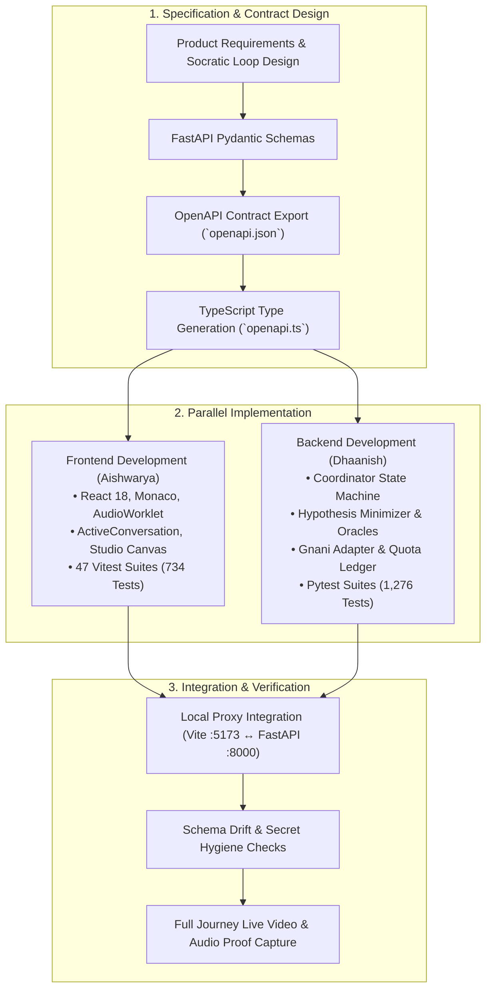

# Team Contributions & Technical Ownership

**Project:** Mentorly *(formerly developed under working titles Voice Coding Coach and Say Why)*  
**Hackathon:** Gnani AI Great Indian AI Internship Challenge  
**Team Members:**  
- **Dhaanish Ahamed B** ([@dhaanish597](https://github.com/dhaanish597)) — Architecture, Backend, Execution Sandboxing & Verification  
- **Aishwarya K** — Frontend Architecture, Voice Experience, Monaco Code Studio & UX  

---

## 1. Project & Team Overview

Mentorly is an interactive, voice-driven coding coach and technical interview practice platform powered by **Gnani AI Vachana Speech Services** (**Prisma v3.0 STT** and **Timbre v3.0 TTS**). Unlike traditional coding platforms that merely evaluate code with basic boolean pass/fail tests, or chatbots that hallucinate code execution results, Mentorly pairs spoken Socratic dialogue with deterministic execution tracing, automated counterexample generation, and guided debugging.

The platform guides learners through an evidence-backed cognitive loop:
$$\text{Explain} \longrightarrow \text{Predict} \longrightarrow \text{Execute} \longrightarrow \text{Inspect} \longrightarrow \text{Repair} \longrightarrow \text{Try a Fresh Case}$$

### Team Structure & Operational Model
The engineering work was executed by a two-member team with complementary areas of specialization:
- **Dhaanish Ahamed B** led the core system architecture, FastAPI backend services, isolated execution sandbox design, deterministic verification engine (Hypothesis property testing and counterexample minimization), and the backend Gnani API gateway with transaction-safe quota management.
- **Aishwarya K** led the frontend application engineering in React 18 and TypeScript, interactive Monaco Editor integration with trace visualizations, browser-side audio capture and real-time resampling via Web Audio AudioWorklet, Gnani SSE/WAV playback handling, the Socratic conversation UI, and the System Design visual studio.

Both team members collaborated closely on API contract design, voice protocol framing, user flow definition, and integration testing.

---

## 2. Git Authorship & Commit History Notice

> [!IMPORTANT]
> **Commit Metadata Disclosure for Technical Evaluators:**  
> In the repository Git history, commits were authored and pushed primarily through Dhaanish's GitHub account (`dhaanish597`). This was a consequence of the team's local development setup, which relied on co-located pair-programming sessions, shared development checkouts, and a single consolidated deployment pipeline. Aishwarya actively co-developed the frontend codebase, voice interfaces, and interaction components, but did not push from an independent Git identity.  
>  
> Consequently, **commit frequency, author lines, and Git metadata do not represent the actual distribution of engineering effort.** Evaluators and interviewers should evaluate the team's work based on the module ownership matrix, technical component descriptions, and architectural artifacts documented below.

---

## 3. Individual Technical Contributions

### Dhaanish Ahamed B — Architecture, Backend and Verification

#### A. System Concept, Architecture & API Infrastructure
- Designed the end-to-end system architecture separating the client layer, coordinator backend, verification/worker engine, and external Gnani speech infrastructure.
- Implemented the core FastAPI application ([`main.py`](file:///Users/dhaanish/Desktop/VIVA/implementation/backend/app/main.py)) with strict Pydantic v2 domain schemas, dependency injection, and centralized lifecycle management.
- Developed the coordinator state machine ([`state_machine.py`](file:///Users/dhaanish/Desktop/VIVA/implementation/backend/app/orchestration/state_machine.py)) governing learning states (`EXPLAINING`, `AWAITING_PREDICTION`, `VERIFYING`, `INSPECTING_RESULT`, `REPAIR_REQUIRED`, `FRESH_CASE_CHECK`, `PRACTICE_CHECKPOINT_COMPLETED`).
- Structured capability-based session authorization tokens, eliminating persistent user session vulnerabilities while securing workspace mutations.

#### B. Deterministic Verification & Counterexample Generation
- Engineered the property-based verification engine using Hypothesis ([`hypothesis_strategies.py`](file:///Users/dhaanish/Desktop/VIVA/implementation/backend/app/verification/hypothesis_strategies.py)), generating targeted edge-case inputs for algorithmic problems.
- Built the automated counterexample minimizer ([`minimizer.py`](file:///Users/dhaanish/Desktop/VIVA/implementation/backend/app/verification/minimizer.py)) using binary and delta shrinking to reduce large failing test cases to minimal reproducible inputs within bounded wall-clock budgets.
- Authored formal problem specifications, reference oracles, and deterministic comparators across algorithmic challenge modules ([`exercises/`](file:///Users/dhaanish/Desktop/VIVA/implementation/backend/app/exercises/)), including Shortest Subarray, Binary Search boundary conditions, and Maximum Product Subarray.

#### C. Sandboxed Execution Architecture
- Architected the multi-tier execution sandbox ([`exec_worker/`](file:///Users/dhaanish/Desktop/VIVA/implementation/exec_worker/)) separating untrusted student code execution from backend business logic.
- Configured disposable container runner specifications using gVisor (`runsc`) ([`Dockerfile.runner`](file:///Users/dhaanish/Desktop/VIVA/implementation/exec_worker/Dockerfile.runner)) with fail-closed security controls: network isolation (`deny-all`), bounded CPU/memory quotas, process tree isolation, and strict wall-clock timeouts.
- Built the in-sandbox execution tracer ([`runner/in_sandbox_tracer.py`](file:///Users/dhaanish/Desktop/VIVA/implementation/exec_worker/runner/in_sandbox_tracer.py)) that inspects line executions and captures local variable mutations without altering runtime behavior.

#### D. Gnani AI Backend Integration & Quota Scheduling
- Implemented the production Gnani Vachana adapter ([`gnani_adapter.py`](file:///Users/dhaanish/Desktop/VIVA/implementation/backend/app/speech/gnani_adapter.py)) supporting REST STT (`POST https://api.vachana.ai/stt/v3`), streaming WebSocket STT (`wss://api.vachana.ai/stt/v3/stream`), and SSE TTS (`POST https://api.vachana.ai/api/v1/tts/sse`).
- Built the concurrency gatekeeper ([`gatekeeper.py`](file:///Users/dhaanish/Desktop/VIVA/implementation/backend/app/speech/gatekeeper.py)) featuring a single-slot bounded dispatcher (`speech_slot`) to respect Gnani account concurrency limits without dropping learner turns.
- Designed transaction-backed usage accounting in SQLite (`usage_reservations`, `module_speech_usage`), tracking session STT audio seconds and TTS synthesized characters against strict daily quotas.
- Implemented deterministic disk-level audio caching ([`tts_cache.py`](file:///Users/dhaanish/Desktop/VIVA/implementation/backend/app/speech/tts_cache.py)) keyed by SHA-256 hash of text, voice persona, language mode, and model identifier.

#### E. AI Coaching Logic & Reasoning Workflow
- Created the Socratic dialogue engine ([`coach_engine.py`](file:///Users/dhaanish/Desktop/VIVA/implementation/backend/app/coaching/coach_engine.py)) generating graduated hints and targeted diagnostic questions based on execution failure modes.
- Implemented the student claim extractor ([`claim_extractor.py`](file:///Users/dhaanish/Desktop/VIVA/implementation/backend/app/coaching/claim_extractor.py)) parsing spoken reasoning into structured hypotheses without allowing LLM hallucinations to determine execution truth.
- Configured distinct mentor personas ([`teachers.py`](file:///Users/dhaanish/Desktop/VIVA/implementation/backend/app/coaching/teachers.py)) for curriculum areas: Astra (Algorithms), Veda (Quantitative Logic), Nexus (Systems Architecture), and Corel (CS Fundamentals).

#### F. Data Persistence, Reliability & Verification
- Designed the SQLite schema with WAL (Write-Ahead Logging) mode and executed 31+ ordered transactional migrations ([`migrations/`](file:///Users/dhaanish/Desktop/VIVA/implementation/backend/app/db/migrations/)) with pre-migration snapshot backups.
- Authored verification scripts including schema drift detection ([`check_schema_drift.py`](file:///Users/dhaanish/Desktop/VIVA/implementation/scripts/check_schema_drift.py)) and secret hygiene scanning ([`check_secrets.py`](file:///Users/dhaanish/Desktop/VIVA/implementation/scripts/check_secrets.py)).
- Led backend unit and integration test development, verifying 1,276 passing tests across the backend and execution worker.

---

### Aishwarya K — Frontend, Voice Experience and UX

#### A. Frontend Application Architecture & Responsive Layout
- Engineered the client application using React 18, TypeScript, and Vite 6 ([`implementation/frontend`](file:///Users/dhaanish/Desktop/VIVA/implementation/frontend/)), enforcing strict typing across all views and services.
- Created the application shell, routing structure ([`ProductApp.tsx`](file:///Users/dhaanish/Desktop/VIVA/implementation/frontend/src/ProductApp.tsx)), and responsive viewports validated across mobile (375px), tablet (768px), and desktop (1366px/1440px).
- Developed the cohesive styling and theme system ([`horizon.css`](file:///Users/dhaanish/Desktop/VIVA/implementation/frontend/src/horizon.css), [`style.css`](file:///Users/dhaanish/Desktop/VIVA/implementation/frontend/src/style.css), [`product-learning.css`](file:///Users/dhaanish/Desktop/VIVA/implementation/frontend/src/product-learning.css)) supporting dark and light modes with high-contrast accessibility standards.

#### B. Monaco Code Studio & Interactive Trace Visualization
- Integrated the Monaco Code Editor ([`PythonEditor.tsx`](file:///Users/dhaanish/Desktop/VIVA/implementation/frontend/src/components/PythonEditor.tsx)) configured with local web workers (`editor.worker.js`) to prevent third-party CDN dependencies and eliminate learner source leaks.
- Implemented dynamic line decorations (`active-trace-line`) and automated viewport scrolling (`revealLineInCenterIfOutsideViewport`) to highlight the executing line during trace playback.
- Built an accessible plain-text fallback toggle (`aria-pressed`), allowing users on screen readers or low-resource devices to seamlessly switch from Monaco to a standard accessible textarea.

#### C. Voice Interaction & Audio Processing Pipeline
- Implemented the browser audio capture pipeline ([`audioRecorder.ts`](file:///Users/dhaanish/Desktop/VIVA/implementation/frontend/src/services/audioRecorder.ts)) using the modern Web Audio API and `AudioWorkletNode`, avoiding deprecated and jank-prone `ScriptProcessorNode` interfaces.
- Implemented the zero-loss `StatefulResampler` ([`audioWorkletProcessor.ts`](file:///Users/dhaanish/Desktop/VIVA/implementation/frontend/src/services/audioWorkletProcessor.ts)) processing 128-sample worklet quanta to convert native browser sample rates (e.g., 44.1 kHz / 48 kHz) into Gnani's exact required format: 16 kHz mono 16-bit linear PCM.
- Built speech activity detection ([`speechActivity.ts`](file:///Users/dhaanish/Desktop/VIVA/implementation/frontend/src/services/speechActivity.ts)) with RMS energy thresholds and silence timers to provide real-time audio level feedback.
- Designed deterministic fallback state machines (`PERMISSION_DENIED_TEXT_FALLBACK`, `DEVICE_LOST_TEXT_FALLBACK`) ensuring learners can continue with typed inputs if microphone permissions fail.

#### D. Gnani Voice Experience & Audio Playback
- Developed the frontend Gnani voice integration component ([`StudioVoice.tsx`](file:///Users/dhaanish/Desktop/VIVA/implementation/frontend/src/StudioVoice.tsx)) and curriculum voice controls ([`ModuleVoice.tsx`](file:///Users/dhaanish/Desktop/VIVA/implementation/frontend/src/voice/ModuleVoice.tsx)).
- Handled real-time SSE streaming and WAV audio playback with strict Blob URL lifecycle management, capping stored audio cache to 12 entries / 8 MiB and revoking object URLs on epoch changes to prevent browser memory leaks.
- Synchronized animated mentor speaking portraits ([`StudioMentor.tsx`](file:///Users/dhaanish/Desktop/VIVA/implementation/frontend/src/StudioMentor.tsx)) with genuine `HTMLMediaElement.play()` playback state rather than asynchronous network loading states.
- Implemented device-level speech preferences ([`preferences.ts`](file:///Users/dhaanish/Desktop/VIVA/implementation/frontend/src/voice/preferences.ts), [`languages.ts`](file:///Users/dhaanish/Desktop/VIVA/implementation/frontend/src/voice/languages.ts)) supporting 10 Indian locales, Tanglish code-mixing (`ta-IN,en-IN`), 13 Timbre voices, volume/speed controls, and cross-tab storage synchronization.

#### E. Socratic Conversation UI & Transcript Rendering
- Built the interactive conversation panel ([`ActiveConversation.tsx`](file:///Users/dhaanish/Desktop/VIVA/implementation/frontend/src/components/ActiveConversation.tsx)) displaying mentor and learner turns with distinct visual avatars and status badges (`listening`, `transcribing`, `thinking`, `playing`, `interrupted`).
- Implemented progressive transcript word reveals synchronized with audio playback progress, delivering a natural spoken-dialogue experience.
- Added copy-to-clipboard transcript export and automated scroll tracking with unread message notifications.

#### F. System Design Studio & Interactive Canvas
- Built the System Design Studio ([`StudioApp.tsx`](file:///Users/dhaanish/Desktop/VIVA/implementation/frontend/src/StudioApp.tsx), [`StudioGraph.tsx`](file:///Users/dhaanish/Desktop/VIVA/implementation/frontend/src/StudioGraph.tsx)) leveraging `@xyflow/react` for visual architectural diagramming.
- Implemented draggable system components (APIs, load balancers, caches, databases), property inspectors ([`StudioProperties.tsx`](file:///Users/dhaanish/Desktop/VIVA/implementation/frontend/src/StudioProperties.tsx)), and live connection management.
- Integrated voice mentoring within the design canvas, allowing learners to verbally defend architectural trade-offs to Nexus.

#### G. Evidence Visualization, Progress & UI Verification
- Built the Workbench evidence panels ([`WorkbenchComponents.tsx`](file:///Users/dhaanish/Desktop/VIVA/implementation/frontend/src/components/WorkbenchComponents.tsx)) displaying side-by-side student vs. reference outputs, execution status badges, and step-by-step variable inspection tables.
- Developed the Curriculum navigation views ([`CurriculumPage.tsx`](file:///Users/dhaanish/Desktop/VIVA/implementation/frontend/src/features/curriculum/CurriculumPage.tsx)), interactive lesson practice ([`LessonPractice.tsx`](file:///Users/dhaanish/Desktop/VIVA/implementation/frontend/src/features/curriculum/LessonPractice.tsx)), and progress tracking dashboards ([`ProgressPage.tsx`](file:///Users/dhaanish/Desktop/VIVA/implementation/frontend/src/features/progress/ProgressPage.tsx)).
- Created immutable mock interview report reviews ([`InterviewReportRoute.tsx`](file:///Users/dhaanish/Desktop/VIVA/implementation/frontend/src/features/interview/InterviewReportRoute.tsx)) showing rubric breakdowns and evidence citations.
- Authored frontend component and unit tests using Vitest and React Testing Library, validating 734 passing tests across 47 suites.

---

## 4. Module Ownership Matrix

The following matrix details the primary and supporting responsibilities for each subsystem in the codebase:

| Technical Component | Primary Responsibility | Supporting Responsibility |
|---|---|---|
| **System Architecture & Data Contracts** | Dhaanish Ahamed B | Aishwarya K |
| **FastAPI Application & Routing Core** | Dhaanish Ahamed B | Aishwarya K |
| **Coordinator State Machine & Turn Lifecycle** | Dhaanish Ahamed B | Aishwarya K |
| **Python Problem Specifications & Reference Oracles** | Dhaanish Ahamed B | Aishwarya K |
| **Hypothesis Property Testing & Case Minimization** | Dhaanish Ahamed B | Aishwarya K |
| **Execution Broker & gVisor Sandbox Worker** | Dhaanish Ahamed B | Aishwarya K |
| **Execution Tracing & Variable Snapshotting** | Dhaanish Ahamed B | Aishwarya K |
| **Gnani Backend Adapter (REST STT, WS STT, SSE TTS)** | Dhaanish Ahamed B | Aishwarya K |
| **Gnani Concurrency Gatekeeper & Disk Cache** | Dhaanish Ahamed B | Aishwarya K |
| **SQLite Schema, Migrations (0001–0031) & WAL** | Dhaanish Ahamed B | Aishwarya K |
| **Socratic Coaching Engine & Prompt Guardrails** | Dhaanish Ahamed B | Aishwarya K |
| **Claim Extraction & Semantic Classification** | Dhaanish Ahamed B | Aishwarya K |
| **Frontend Architecture & React Component Hierarchy** | Aishwarya K | Dhaanish Ahamed B |
| **UI Theme System & Responsive Layout (Mobile/Tablet/Desktop)** | Aishwarya K | Dhaanish Ahamed B |
| **Monaco Editor Integration & Accessible Plain-Text Toggle** | Aishwarya K | Dhaanish Ahamed B |
| **Live Trace Highlighting & Code Line Decorations** | Aishwarya K | Dhaanish Ahamed B |
| **Web Audio AudioWorklet Capture & 16 kHz Resampler** | Aishwarya K | Dhaanish Ahamed B |
| **Speech Activity Detection & Microphone Fallbacks** | Aishwarya K | Dhaanish Ahamed B |
| **Frontend Gnani Voice Controller & Preferences Store** | Aishwarya K | Dhaanish Ahamed B |
| **SSE/WAV Audio Stream Playback & Memory Management** | Aishwarya K | Dhaanish Ahamed B |
| **Active Conversation Panel & Progressive Word Reveal** | Aishwarya K | Dhaanish Ahamed B |
| **System Design Canvas Studio (`@xyflow/react`)** | Aishwarya K | Dhaanish Ahamed B |
| **Evidence Visualization & Trace Step Inspector** | Aishwarya K | Dhaanish Ahamed B |
| **Curriculum Navigation, Practice UI & Progress Tracking** | Aishwarya K | Dhaanish Ahamed B |
| **Interview Assessment Review & Report Viewers** | Aishwarya K | Dhaanish Ahamed B |
| **Client API Error Handling & Degraded State Banners** | Aishwarya K | Dhaanish Ahamed B |
| **Automated Verification: Backend Test Suite (1,276 tests)** | Dhaanish Ahamed B | Aishwarya K |
| **Automated Verification: Frontend Test Suite (734 tests)** | Aishwarya K | Dhaanish Ahamed B |

---

## 5. Shared Development Responsibilities

Beyond their primary individual modules, both team members shared responsibility in several critical engineering and operational domains:

1. **Pedagogical Workflow Design:**  
   Co-designed the six-stage learning loop ($\text{Explain} \to \text{Predict} \to \text{Execute} \to \text{Inspect} \to \text{Repair} \to \text{Fresh Case}$), ensuring that cognitive checkpoints aligned with both Socratic pedagogical principles and deterministic state machine transitions.

2. **API Contract Harmonization:**  
   Maintained clean synchronization between backend Pydantic models and frontend TypeScript interfaces via automated OpenAPI schema generation (`openapi.json` $\to$ `src/types/openapi.ts`). Both members participated in bidirectional review of request/response payloads.

3. **Audio Protocol & Capture Standards:**  
   Collaborated on defining the exact audio constraints required by Gnani Vachana APIs: 16,000 Hz, 16-bit linear mono PCM, maximum 25–30 second turn buffers, and 960,000-byte upload limits.

4. **Integration Testing & Race-Condition Remediation:**  
   Conducted joint debugging sessions to isolate and resolve edge cases, such as stale response arrival when code is modified while speech recognition or test execution is pending, audio stream interruption on turn transition, and device permission changes.

5. **Application Verification & Quality Assurance:**  
   Rigorously executed the verification toolchains before milestone freezes: running Python pytest and coverage suites, Vitest frontend suites, TypeScript typechecks, ESLint rules, schema mutation tests, and secret hygiene audits.

6. **Demonstration & Submission Deliverables:**  
   Authored end-to-end user interaction recording scripts ([`record_full_journey.py`](file:///Users/dhaanish/Desktop/VIVA/recordings/record_full_journey.py), [`record_voice_first.py`](file:///Users/dhaanish/Desktop/VIVA/recordings/record_voice_first.py)), captured audio/video proof artifacts in [`recordings/`](file:///Users/dhaanish/Desktop/VIVA/recordings/), and prepared project documentation for submission to the Gnani AI Hackathon jury.

---

## 6. Collaborative Engineering Workflow

The team adhered to a disciplined, test-verified workflow:
- **Contract-First Development:** API changes were introduced first in backend Pydantic schemas, exported via `export_openapi.py`, and converted into client TypeScript definitions via `openapi-typescript`. This prevented runtime contract mismatches.
- **Bi-Directional Code Reviews:** Changes to audio capture parameters, state transitions, or error envelopes were reviewed jointly before merging into the active branch.
- **Local Isolation First:** All components were developed and verified against local SQLite databases and mockable provider interfaces before running bounded physical Gnani API smoke tests.

---

## 7. Key Technical Challenges Solved Collaboratively

### Challenge 1: Version and Edit Race Conditions (Epoch & Revision Fencing)
- **Problem:** If a learner speaks an explanation, then modifies their code while speech recognition or test execution is processing in the background, a naive system applies the stale audio feedback or old execution result to the new code revision.
- **Solution:** Designed an epoch- and revision-fencing protocol. The backend coordinator tags every job with an immutable `(revision, turn_id)` pair. The frontend tracks an incrementing `epoch` in `StudioVoice.tsx` and `ActiveConversation.tsx`. If code changes occur, pending promises and audio streams are immediately aborted via `AbortController`, preventing stale feedback from polluting the conversation.

### Challenge 2: Zero-Loss Real-Time Audio Resampling (AudioWorklet)
- **Problem:** Modern browsers capture microphone audio at arbitrary hardware sample rates (typically 44.1 kHz or 48 kHz). Gnani Vachana STT requires exactly 16 kHz 16-bit linear mono PCM. Standard HTML5 `ScriptProcessorNode` runs on the main thread and causes frequent audio glitches, dropped buffers, and sample clipping.
- **Solution:** Implemented a dedicated `AudioWorkletNode` running off the main thread with a custom `StatefulResampler`. The resampler processes 128-sample worklet quanta to mathematically convert 375 frames of 128 samples at 48 kHz into exactly 16,000 samples at 16 kHz without dropped samples, clipping, or main-thread UI jank.

### Challenge 3: Fail-Closed Sandboxed Code Execution
- **Problem:** Executing arbitrary learner code on the host machine using ordinary Python `subprocess` or `RestrictedPython` exposes the server to container breakouts, resource starvation, and secret leakage.
- **Solution:** Designed a multi-tier sandbox architecture isolating learner code inside disposable gVisor (`runsc`) containers. The runner has zero network access (`--net=none`), strict read-only root filesystems, capped memory (64 MB), bounded CPU limits, process group limits, and a 1.5-second hard wall-clock kill switch. If the sandbox environment is unavailable, the coordinator fails closed rather than executing unsafe code on the host.

### Challenge 4: Fair-Share Scheduling under Gnani Concurrency Limits
- **Problem:** Developer accounts on speech APIs enforce strict concurrency limits (e.g., 1 active concurrent request). Rapid multi-turn user requests or automated test runs can trigger `429 Too Many Requests` or dropped connections.
- **Solution:** Built a centralized backend gatekeeper with an `asyncio.BoundedSemaphore(1)` dispatcher. Coupled with an SQLite WAL transaction ledger (`usage_reservations`), every incoming TTS/STT request acquires a transactional reservation slot. If a retry is necessary, it is admitted against the daily allowance without duplicate audio charges. A SHA-256 disk cache serves repetitive system prompts with zero provider latency and zero API cost.

### Challenge 5: Grounded Reasoning vs. LLM Hallucination
- **Problem:** Commercial conversational interview tools frequently use ungrounded LLMs to assess code correctness, leading to hallucinations where wrong code is praised or valid alternative algorithms are rejected.
- **Solution:** Separated natural language conversation from code verification. Learner code is executed against deterministic reference oracles and property-based test suites. The Socratic coach is fed verified execution artifacts (actual input, student output, oracle output, and trace snapshots) as ground truth, guaranteeing that feedback reflects actual execution behavior.

### Challenge 6: Accessible Graceful Degradation (Typed Fallback)
- **Problem:** In noisy environments, on restricted devices, or when browser microphone permissions are denied, a voice-only platform becomes completely unusable.
- **Solution:** Engineered immediate, graceful degradation to text. When microphone access is rejected, the UI transitions to `PERMISSION_DENIED_TEXT_FALLBACK`. The learner can type their explanation or predictions, and Monaco can be toggled to an accessible plain-text editor, preserving the complete six-stage learning flow without blocking progress.

---

## 8. Verification & Attribution Notes

To maintain complete transparency and technical integrity for hackathon evaluators:

1. **Commit History vs. Team Allocation:**  
   As noted in Section 2, all Git commits on branch `engineering/full-product-integration-20261115` reflect Dhaanish's committer credentials. The individual responsibilities described in Sections 3 and 4 represent the actual division of system components and co-developed source code agreed upon by the team.

2. **Verified Code References:**  
   All described modules, interfaces, and tools exist in the active codebase:
   - Backend source: [`implementation/backend/app/`](file:///Users/dhaanish/Desktop/VIVA/implementation/backend/app/)
   - Frontend source: [`implementation/frontend/src/`](file:///Users/dhaanish/Desktop/VIVA/implementation/frontend/src/)
   - Sandbox runner: [`implementation/exec_worker/`](file:///Users/dhaanish/Desktop/VIVA/implementation/exec_worker/)
   - Automated test suites: [`implementation/backend/tests/`](file:///Users/dhaanish/Desktop/VIVA/implementation/backend/tests/), [`implementation/frontend/src/__tests__/`](file:///Users/dhaanish/Desktop/VIVA/implementation/frontend/src/__tests__/)
   - Interaction proofs & media: [`recordings/`](file:///Users/dhaanish/Desktop/VIVA/recordings/)

3. **External Deployment Status:**  
   As documented in [`DEPLOYMENT_STATUS.md`](file:///Users/dhaanish/Desktop/VIVA/DEPLOYMENT_STATUS.md), public arbitrary code execution and multi-tenant PostgreSQL clustering remain experimental release gates. The platform is fully verified and demonstrated in its local production-candidate mode (`FastAPI :8000` + `Vite :5173` with SQLite WAL).

---

*Document compiled collaboratively by Dhaanish Ahamed B and Aishwarya K for the Gnani AI Great Indian AI Internship Challenge submission.*
