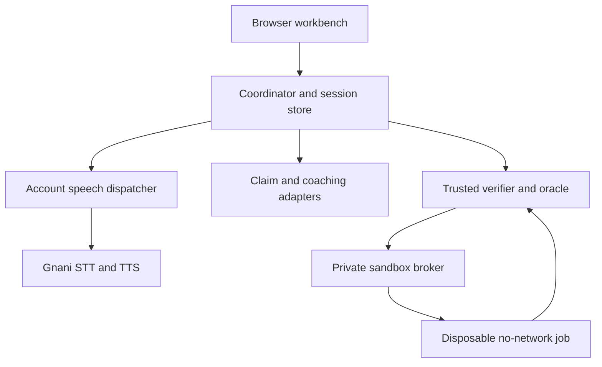

# Voice Coding Coach — Complete Architectural & Implementation Specification

> **Document Status:** Authoritative Technical Specification & Build Plan (`v2.0.0`, audited 12 November 2026)  
> **Project Placeholder Name:** **Voice Coding Coach** *(Final product name is **UNDECIDED**; "Say Why," "Viva-Setu," and "CodeSwar" are historical working titles and must never be hardcoded into package names, repository paths, database identifiers, environment variables, URLs, UI copy, or deployment resources. See [Section 4.8](#48-single-configurable-branding-location) for the single branding configuration mechanism.)*  
> **Competition Context:** [Gnani AI Great Indian AI Internship Challenge](https://www.gnani.ai/internship) (Submission Deadline: **Sunday, 15 November 2026, 18:00 IST**)  
> **Team Composition:** Two-member engineering team (`Builder A` & `Builder B`)
> **Latest user directive:** Implement the complete selected product in dependency-ordered phases. No feature may be removed, permanently disabled or left unfinished to fit a two/three-day schedule. Name remains undecided. Implementation is authorized.
> **Execution method:** Astra coordinates; GPT-6.1 Sol and GPT-6.1 Terra handle bounded implementation/review tasks when available. Read applicable skills and repository instructions. Use `superpowers:subagent-driven-development` or `superpowers:executing-plans` as available; the user's already-authorized execution method takes precedence over redundant approval gates.
> **Scope and status:** This is a specification, not evidence that the application exists. See §12 for completion gates and §15 for status. The Mac repository was not accessible during this audit. A portable trusted-exercise foundation is delivered separately for inspected integration.
> **Architecture:** Browser workbench → authenticated coordinator and speech adapters → trusted verifier/broker → disposable isolated student-code invocation. Trusted oracles remain outside student-code execution.
> **Source precedence:** Latest user instructions, this corrected plan, audited blueprint, verified current technical/competition sources, historical research. External facts are governed by official current sources, not document precedence.


---

## Table of Contents

- [0. Source reconciliation and evidence status](#0-source-reconciliation-and-evidence-status)
- [1. Product Contract](#1-product-contract)
- [2. Screen-by-Screen User Experience](#2-screen-by-screen-user-experience)
- [3. Exercise Specifications](#3-exercise-specifications)
- [4. Architecture and stack decisions](#4-architecture-and-stack-decisions)
- [5. Module and File Plan](#5-module-and-file-plan)
- [6. API, persistence and immutable evidence contracts](#6-api-persistence-and-immutable-evidence-contracts)
- [7. State transitions and concurrency](#7-state-transitions-and-concurrency)
- [8. Gnani integration specification](#8-gnani-integration-specification)
- [9. Code execution and verification specification](#9-code-execution-and-verification-specification)
- [10. Coaching and interpretation](#10-coaching-and-interpretation)
- [11. Test and evaluation plan](#11-test-and-evaluation-plan)
- [12. Full-scope phased implementation](#12-full-scope-phased-implementation)
- [13. Deployment, Operations and Cost](#13-deployment-operations-and-cost)
- [14. Demo and Submission Readiness](#14-demo-and-submission-readiness)
- [15. Traceability, risks and actual status](#15-traceability-risks-and-actual-status)

---

## 0. Source reconciliation and evidence status

### 0.1 What was actually inspected

Gemini reported inventorying `/Users/dhaanish/Documents/VIVA`. This audit inspected the supplied 1,352-line `IMPLEMENTATION_PLAN.md`, the available blueprint and official-site brief, and relevant official documentation. The Mac directory is not mounted here. Gemini's claim that every local file was inspected is historical provenance, not a claim verified by this audit. Local Codex must inventory the real folder before editing; read all relevant source documents, nested instructions and existing code, and classify generated/vendor/binary files without printing secrets. Read a supported attachment in full rather than relying on its filename or summary. Record inaccessible files explicitly.

| Source | Role in this revision |
|---|---|
| Latest user instructions | Full selected scope; two teammates; undecided branding; phased execution authorized; Astra + Sol/Terra requested |
| `IMPLEMENTATION_PLAN.md` v1 | Detailed baseline retained and corrected; old deadline cuts superseded |
| `Say_Why_Audit_and_Team_Build_Blueprint.md` | Earlier corrections and selected teaching workflow; time-based reductions superseded |
| `Gnani_AI_Internship_Challenge_Official_Website_Brief.md` | Rule cross-check; its content does not support Gemini's percentage scoring rubric |
| `Gnani AI Hackathon Strategy.md` and the two investigation PDFs | Historical alternatives and rationale; not authority to resurrect rejected claims or unrelated products |
| Official Gnani STT REST, STT WebSocket and TTS SSE documentation | Wire-format corrections checked on 12 November 2026; account access still untested |
| Official competition page | Deadline, public demo, required hashtags and engagement-based shortlist checked on 12 November 2026 |

### 0.2 Evidence categories

- **User requirements:** all FR/NFR entries and completion tasks in this plan remain in scope. Features formerly optional at runtime (LLM assistance, WebSocket transport) still require implemented and tested paths; they need not be enabled for every session.
- **Design choices:** React/TypeScript/Vite workbench, FastAPI/Python, initially single-process SQLite coordinator, trusted execution broker and gVisor jobs. Dependency versions must be resolved and locked on the actual environment, not copied as alleged latest versions.
- **Externally documented:** wire formats and rules linked in §8 and §14. Documentation verification is not a successful live-account test.
- **Unverified until measured:** API entitlement, actual concurrency, cost conversion, language accuracy, latency, deployed isolation, model availability, browser support and benchmark results.
- **Nonblocking decisions:** final name, visual brand and final public handles. Placeholder branding is sufficient for implementation. Keys belong in local secret configuration, never a prompt or repository.

### 0.3 Review focus

The highest-risk integration inputs are delayed code saves; a new speech turn on unchanged code; a failing case different from the predicted case; malicious/resource-exhausting code; and microphone/provider failures during a pending challenge. §6, §9 and §12 require tests for each. No shortlist probability or guaranteed selection is implied by this plan.

---

## 1. Product Contract

### 1.1 Problem Statement & Target Users
Indian Computer Science engineering students frequently write code that passes basic sample inputs—or memorize standard algorithmic templates—without being able to articulate *why* their boundary conditions, loop invariants, or domain assumptions hold during technical interviews and viva examinations. The selected opportunity is a focused practice workflow that connects a learner’s confirmed spoken prediction to reproducible execution and a fresh transfer task. Do not claim HackerRank Chakra or other competitors lack these capabilities without a current, product-specific comparison. This project differentiates through its implemented workflow and measured evidence, not blanket competitor assertions.

**Target Users:**
1. **Primary:** Undergraduate CS/IT students in India preparing for technical placement interviews and lab vivas who think and speak in Indian English (`en-IN`) or Tamil-English code-switched speech (`ta-IN,en-IN`).
2. **Secondary (Evaluators):** Gnani AI engineering judges and technical interviewers assessing interactive voice AI engineering depth, latency discipline, and execution-grounded verification.

### 1.2 Intended Outcomes
1. Learners verbally explain their algorithm's behavior and explicitly predict what their current code will return on a specific edge-case or counterexample input before seeing the execution result.
2. Misheard technical tokens (variable names, comparators, negations, array values) are caught and corrected via a lightweight confirmation step before the system evaluates the learner's claim.
3. Every corrective coaching prompt is backed by a reproducible execution artifact (`EvidenceArtifact`) bound to the exact `code_version_id` and `spec_version`.
4. After fixing a bug, the learner must accurately predict or explain the code's behavior on a **fresh transfer case** before the concept is marked complete.

### 1.3 One-Sentence Product Description
**Voice Coding Coach** is a browser-based, bilingual (`en-IN` and Tanglish `ta-IN,en-IN`) voice-driven Python coding coach powered by Gnani Vachana STT/TTS that pairs correctable speech understanding with sandboxed execution tracing and counterexample search to guide learners through explaining, predicting, debugging, and verifying algorithmic boundary conditions.

### 1.4 User Stories

- **US-01 (Exercise & Audio Setup):** As a learner, I want to select a supported Python exercise, see its explicit input domain constraints, choose English or Tamil-English voice mode, and verify my microphone works so that I can begin a coaching session with clear expectations.
- **US-02 (Correctable Speech & Claim Confirmation):** As a learner explaining my code or predicting an output aloud, I want to see the critical tokens extracted from my speech (function inputs, expected output, key condition, or negation) and fix any speech-recognition errors in one click or short re-utterance before the coach judges my reasoning.
- **US-03 (Execution-Grounded Prediction Check):** As a learner who believes my code handles a domain or edge case, I want the coach to find a small reproducibly failing counterexample (or concrete trace step), ask me what my code will output on that exact input, and show me the side-by-side comparison of my prediction, my code's actual execution trace, and the expected reference output.
- **US-04 (Graduated Socratic Coaching):** As a learner whose code or prediction failed, I want to receive a targeted question first and unlock deeper hints (trace pointer → structural fix direction) only when I ask or remain stuck, rather than having the full answer spoiled immediately.
- **US-05 (Domain Evolution & Fresh-Case Transfer):** As a learner who repairs my code or adapts to an announced constraint change (such as allowing negative numbers in a subarray problem), I want to rerun tests and predict the output on a fresh, unseen test case to verify that my understanding transfers beyond the single bug I just fixed.
- **US-06 (Safe Demo Fallback & Public Access):** As a hackathon evaluator testing the live public link, I want to experience live Gnani voice interaction when capacity is available, or seamlessly switch to deterministic interactive demo presets / text-input fallback with clear status indicators if the public speech queue is full.

### 1.5 Functional Requirements & Acceptance Criteria

| Req ID | Requirement Statement | Acceptance Criteria (Given / When / Then) |
| :--- | :--- | :--- |
| **FR-01** | **Configurable Branding Isolation:** All user-facing product names and taglines must read from a single configuration source (`config/branding.json`). | **Given** `config/branding.json` sets `"productName": "CustomCoach"`, **When** the frontend and backend start, **Then** the header title, page `<title>`, session export header, and API health metadata reflect `"CustomCoach"` with zero code edits. |
| **FR-02** | **Exercise & Spec-Version Selection:** Support 3 exercises (`shortest_subarray_ge_target` with `v1_positive_only` and `v2_negatives_allowed`, `first_at_least`, `max_product_subarray`) with visible mathematical constraints and starter templates. | **Given** a learner selects an exercise, **When** the workspace loads, **Then** the problem statement, legal input domain, starter code, and active `spec_version` badge render accurately. |
| **FR-03** | **Code Versioning & AST Symbol Extraction:** Every changed committed source receives a monotonic `code_version_id` and separate SHA-256 hash and extracts Python AST identifiers (`FunctionDef`, `arg`, `Name`) within `<= 50 ms`. | **Given** the learner edits code in Monaco, **When** a compare-and-swap code save succeeds with changed source, **Then** a new `code_version_id` is stored, any in-flight analysis for an older version is marked `SUPERSEDED`, and extracted AST identifiers are returned for STT biasing. |
| **FR-04** | **Gnani Speech Recognition with Context Biasing:** Capture 16 kHz mono PCM/WAV audio and transcribe via Gnani `prisma-v3.0` (`en-IN` or `ta-IN,en-IN` with `format="codemix"`), supplying AST `keyterms`, exercise `topic`, and prior turn `previous_text`. | **Given** a recorded audio turn (`<= 30 s`), **When** submitted to `/api/v1/sessions/{id}/turns/audio`, **Then** the backend calls Gnani Vachana STT with `model="prisma-v3.0"`, logs the Gnani `request_id`, and stores both `raw_transcript` and `normalized_transcript`. |
| **FR-05** | **Critical-Token Interpretation & User Confirmation Gate:** Extract structured claims (`ClaimInterpretation`) and require learner confirmation or quick-chip editing whenever a claim or prediction will be evaluated; provider confidence is nullable and is not assumed calibrated. | **Given** a transcript containing a claim or prediction, **When** extraction completes, **Then** the UI displays the parsed claim chips (e.g., `Input: [1, -1, 5], target=5`, `Predicted Return: 1`, `Polarity: Affirmative`) with `Confirm` and inline edit controls before triggering corrective coaching. |
| **FR-06** | **Sandboxed Execution & Bounded Counterexample Search:** Run student Python code in a fresh no-network gVisor sandbox launched by a trusted broker against curated edge cases and bounded Hypothesis generators (separate bounded search, per-invocation and job deadlines; see §9). | **Given** a confirmed code version and active `spec_version`, **When** verification runs, **Then** the worker executes in an isolated container, replays any discovered counterexample against both student code and reference oracle, and returns an `EvidenceArtifact` with explicit status (all §6 verification statuses, including incomplete, unavailable and unconfirmed replay). |
| **FR-07** | **Bounded Step-by-Step Trace Capture:** Record safely serialized best-effort execution snapshots (at most 250 retained events, with explicit attribution/partial status) for the student's code on the target input. | **Given** a specific input (counterexample or user-chosen test), **When** the broker requests a separate trace sandbox invocation, **Then** each retained trace event identifies its actual source/frame and attribution; ambiguous and exceptional states are explicitly labelled, enabling forward/backward scrubbing in the UI. |
| **FR-08** | **Spoken Prediction vs. Execution Evidence Binding:** Require the learner to predict their code's output (or first wrong step) on a specific test input before revealing the execution result and trace comparison. | **Given** a confirmed counterexample or fresh test case `X`, **When** the coach prompts the learner for their prediction on `X`, **Then** the actual output and trace remain hidden until the learner submits and confirms a prediction (spoken or typed fallback). |
| **FR-09** | **Separate Code-Test Evidence vs. Explanation Evidence:** Track code test status (`CODE_PASSES_BOUNDED_SUITE` vs. `CODE_FAILS_CASE`) independently from explanation/prediction status (`MATCH`, `MISMATCH`, `NOT_EVALUATED`). | **Given** student code passes all bounded tests (`NO_FAILURE_FOUND`), **When** the learner makes an inaccurate spoken prediction or unsupported complexity/invariant claim, **Then** the UI shows code tests passing while coaching addresses the confirmed prediction mismatch or marks the abstract claim NOT_EVALUATED without claiming the code failed. |
| **FR-10** | **Graduated 3-Level Coaching & Hint Policy:** Deliver Socratic coaching in 3 explicit levels: Level 1 (Diagnostic Question + Counterexample Input), Level 2 (Concrete Trace Step Pointer), Level 3 (Structural Repair Principle without dumping full solution code). | **Given** a verified discrepancy in `EvidenceArtifact`, **When** coaching is generated, **Then** Level 1 is presented first, and Levels 2 and 3 unlock sequentially upon learner request or repeated failure. |
| **FR-11** | **Pre-TTS Technical Normalization & Gnani Timbre v3.0 Synthesis:** Convert code symbols, array literals, negative numbers, and comparators into natural spoken phrasing before calling Gnani TTS (`model="timbre-v3.0"`), with SHA-256 audio caching and instant barge-in stop. | **Given** coaching text containing `nums = [1, -1, 5]` and `curr_sum >= target`, **When** passed through `PreTTSNormalizer`, **Then** the TTS payload reads `"nums equals 1, minus 1, 5"` and `"curr sum is greater than or equal to target"`, plays in the browser, and stops within `<= 150 ms` if the user clicks `Speak` or `Stop Audio`. |
| **FR-12** | **Announced Domain Change & Fresh-Case Transfer Gate:** Support explicit domain transitions (e.g., `v1_positive_only` → `v2_negatives_allowed` in Exercise 1) and require a fresh-case prediction check after any bug repair before recording a completed practice checkpoint. | **Given** a learner repairs a failing implementation so the original counterexample passes, **When** the complete required bounded-verification policy succeeds, **Then** the state machine transitions to `FRESH_CASE_CHECK`, presents an unseen holdout input, and requires a correct prediction before transitioning to `EXERCISE_COMPLETED`. |
| **FR-13** | **Stale-Turn Cancellation & Browser Playback Acknowledgement:** Bind every STT, execution, LLM, and TTS operation to `(session_id, turn_id, turn_generation, code_version_id, code_hash, spec_version)` and advance turn state to `COACH_PROMPT_DELIVERED` only when the browser sends `playback_ack` (or text-read fallback ack). | **Given** an analysis is running for `code_version_id = v4`, **When** the learner edits code to `v5`, **Then** `v4` results are discarded as `SUPERSEDED` and never spoken or displayed as active feedback for `v5`. |
| **FR-14** | **Graceful Fallbacks & Public Demo Queue:** Provide typed claim/prediction input when mic permissions are denied or STT returns empty (`NO_SPEECH_DETECTED`), and enforce a global concurrency gate (`VCC_GNANI_MAX_CONCURRENCY`) with queue status and pre-verified interactive demo presets. | **Given** Gnani returns `429 RATE_LIMITED` or the concurrency queue exceeds wait thresholds, **When** a turn is submitted, **Then** the user sees a clear queue/retry status and can continue via cached TTS or text confirmation without crashing the session. |

### 1.6 Nonfunctional Requirements

| ID | Category | Specification & Target Metric |
| :--- | :--- | :--- |
| **NFR-01** | **End-to-End Turn Latency** | Median time from user clicking `Check Reasoning / Done Speaking` (`T_turn_end`) to visible `ClaimInterpretation` confirmation card: **`<= 1.8 s`** (REST STT on `< 12 s` audio). Median time from confirmation click (`T_confirm`) to visible `EvidenceArtifact` + coaching card: **`<= 1.2 s`**, and to first TTS audio playback (`T_first_audio_play`): **`<= 2.2 s`**. |
| **NFR-02** | **Execution Isolation** | Meet §9 deployed per-invocation isolation controls and adversarial acceptance tests. Configure and enforce measured resource budgets; no claim of an absolute security guarantee. |
| **NFR-03** | **Version Consistency** | `0%` rate of stale execution traces or coaching prompts applied to a newer `code_version_id` under rapid concurrent editing tests. |
| **NFR-04** | **Cost Protection** | Separate STT-second, TTS-character and request caps; atomic reservations; verified tariff conversion only when available; private cache lifecycle and explicit unknown balance. See §13.3. |
| **NFR-05** | **Privacy, Consent & Retention** | Raw audio is discarded after transcription by default. Session records expire after 24 hours or on authorized deletion; opt-in evaluation recordings use separate consent and retention. Document provider/backups limitations. These controls are not a legal-compliance certification. |
| **NFR-06** | **Accessibility & Keyboard Support** | Full keyboard navigation (`Space` or `Alt+R` for push-to-talk, `Enter` to confirm interpretation, `ArrowLeft`/`ArrowRight` to scrub trace steps), high-contrast visual captions for all spoken output, and screen-reader ARIA live regions for state transitions. |
| **NFR-07** | **Auditability & Reproducibility** | Every coaching turn persists a self-contained JSON `EvidenceArtifact` containing `spec_version`, `code_hash`, `turn_id`, `confirmed_prediction`, `input_args`, `student_output`, `reference_output`, `verification_status`, `trace_id`, `hypothesis_stats`, and stage latency timestamps. |

### 1.7 Explicit Scope Boundaries (What We Are & Are Not Building)

| In Scope (Initial Build) | Explicitly Out of Scope (Non-Goals) |
| :--- | :--- |
| Browser web application (Desktop Chrome/Edge/Firefox primary). | Native iOS/Android apps or IDE plugins (VS Code/JetBrains extensions). |
| Python 3.11 functions for 3 carefully engineered exercise families. | Arbitrary multi-file repositories, C++/Java/JS compilers, SQL/system design prompts, or unrestricted third-party library imports (`numpy`, `pandas`, `requests`). |
| Indian English (`en-IN`) and Tamil-English (`ta-IN,en-IN` codemix) voice interaction via Gnani Vachana STT (`prisma-v3.0`) and TTS (`timbre-v3.0`). | Claims of supporting 12+ languages or Hindi (`hi-IN`) unless validated by a separate 24-clip speaker benchmark (not in initial scope). |
| Bounded property-based counterexample search + curated edge-case suite + bounded best-effort trace capture. | Formal theorem proving, symbolic execution (Z3/angr), or claiming that passing finite tests proves universal algorithm correctness. |
| Single-learner interactive coaching sessions + reproducible evaluation harness. | Multi-tenant enterprise hiring dashboards, proctoring/cheating detection, webcam eye-tracking, voice cloning, or automated grading leaderboards. |

### 1.8 What the Application Can and Cannot Conclude (Epistemic Honesty Rules)

| Evidence Observed by System | What the App CAN Conclude & State | What the App CANNOT Conclude & Must Never State |
| :--- | :--- | :--- |
| Student code raises an exception or returns `3` when reference oracle returns `1` on `nums=[1, -1, 5], target=5`. | **"Confirmed Counterexample (`COUNTEREXAMPLE_CONFIRMED`):"** On input `nums=[1, -1, 5], target=5`, your code returned `3`, whereas the shortest subarray with sum `>= 5` is `[5]` of length `1`. | Cannot conclude *which mental model* caused the bug until the learner explains or predicts, and cannot claim the student's variable names must match the reference oracle's variable names. |
| Student code passes all curated edge cases and `N` bounded Hypothesis examples (`NO_FAILURE_FOUND`). | **"No Failure Found Within Bounded Test Domain (`NO_FAILURE_FOUND`):"** Your code passed `12` deterministic edge cases and `100` generated inputs within the bounded domain (`len <= 15`). | **Never state:** `"200/200 properties proved"`, `"Algorithm proven 100% correct"`, or `"Your understanding is verified"` (passing tests alone never proves conceptual understanding). |
| Student predicts their code will return `1` on `nums=[1, -1, 5], target=5`, and execution actually returns `3`. | **"Prediction Mismatch (`PREDICTION_MISMATCH`):"** You predicted your code would return `1`, but execution on `nums=[1, -1, 5], target=5` returned `3` at line `14`. | Cannot conclude the student failed to hear the question if STT confidence was low unless the student **explicitly confirmed** the prediction chip first. |
| Student makes an abstract spoken claim outside the structured claim grammar (e.g., discussing CPU cache locality or amortized OS paging). | **"Unsupported Claim Scope (`UNSUPPORTED_CLAIM`):"** State politely that the coach verifies input-output predictions, boundary conditions, and trace states for the current exercise, and invite a concrete prediction on the active test input. | Never hallucinate a fake counterexample or pretend to verify arbitrary free-form theoretical claims that cannot be tested against the exercise oracle. |

---

## 2. Screen-by-Screen User Experience

### 2.1 High-Level Workspace Layout

Desktop workbench: problem and coaching panel (28%), editor and execution trace (42%), voice/confirmation/prediction panel (30%). On narrow viewports use accessible tabs with preserved state and visible voice controls. Header exposes exercise, acknowledged domain, language and live/demo status. Footer exposes progress, session deletion and a collapsible technical diagnostics drawer. Learner labels remain plain: “Confirm what you said”, “Your prediction and actual run”, “Trace”, “Try a fresh case”. Engineering IDs and timings belong in diagnostics, subject to reveal authorization.

---

### 2.2 Screen and Panel Specifications (13 Required Views/States)

1. **Entry & Exercise Selection Modal / Header Bar:**
   - Displays the 3 supported exercises with difficulty tags, core concept badges (*Sliding Window & Negative Domain Shift*, *Binary Search Lower-Bound Invariant*, *Dynamic Programming Sign-Flip State*), and a `"Start Coaching Session"` button plus a `"Load Judge Demo Preset"` quick-selector.
2. **Exercise Constraints & Language Choice Panel (Left Panel Top):**
   - Renders the function signature, explicit mathematical constraints (e.g., `1 <= len(nums) <= 15`, `1 <= nums[i] <= 50` in `v1_positive_only`), boundary rules, and language selector (`English (en-IN)` vs. `Tanglish / Tamil-English (ta-IN,en-IN)`).
   - When a domain transition occurs (e.g., unlocking `v2_negatives_allowed` where `-20 <= nums[i] <= 50`), highlights the changed constraint in an amber **Domain Update Banner** requiring the learner to click `"Acknowledge New Constraints"` before testing.
3. **Microphone Permissions & Audio Setup Bar:**
   - Pre-flight check button `"Test Mic & Speaker"` that captures 2 seconds of local WebAudio RMS level to confirm non-zero input (`peak_rms > 0.01`), checks `AudioContext` state, and offers an immediate toggle `"Use Typed Fallback Mode"` if the user has no microphone or denies permission.
4. **Code Editor Panel (Center Panel Top):**
   - Monaco editor configured for Python 3.11, line numbers, syntax highlighting, and inline execution-line highlight markers.
   - Displays current version badge (`Code v1`, `Code v2`...) and an amber `"Edited since last verification"` indicator whenever the buffer diverges from the last verified `code_version_id`.
5. **Transcript & Interpretation Confirmation Card (Right Panel Top):**
   - Displays the learner's raw transcript alongside editable **Critical Token Chips**:
     - `Claim Type`: `[Algorithm Approach | Output Prediction | Edge-Case Claim | Question]`
     - `Target Input`: e.g., `nums = [1, -1, 5], target = 5`
     - `Predicted Return`: e.g., `1` (with quick `+ / -` sign toggle and numeric/boolean input box)
     - `Key Mechanism / Condition`: e.g., `shrink left pointer while curr_sum >= target`
     - `Polarity`: `Works / Holds` vs. `Fails / Breaks`
   - Includes primary action `"Confirm & Check"` (`Enter`) and secondary actions `"Edit Chips"` or `"Re-record"`.
6. **Prediction Capture Card (Right Panel Middle):**
   - When the system has selected a concrete test case or counterexample `X` (e.g., `nums = [-3, -3, -3]`), locks the execution reveal behind a focused prompt: *"Before we run this, what will your current code (Code v2) return on `nums = [-3, -3, -3]`?"*
   - Accepts either a spoken answer (routed through the Confirmation Card) or a direct typed return value + 1-sentence reason.
7. **Execution / Result Comparison View (Center Panel Bottom - Tab 1):**
   - Side-by-side 3-column comparison card bound to `EvidenceArtifact`:
     - **Your Confirmed Prediction:** e.g., `9`
     - **Your Code's Actual Result (`Code v2`):** e.g., `81` (Highlighted in coral if mismatched)
     - **Expected Reference Result (`Spec v1`):** e.g., `9`
   - Clearly badges whether the outcome is a **Code Failure + Prediction Mismatch**, **Code Failure (Correctly Predicted by You)**, or **Code Passed Bounded Suite**.
8. **Trace Navigation View (Center Panel Bottom - Tab 2):**
   - Interactive timeline scrubber (`Step 1 of 14` with `|<`, `< Prev`, `Next >`, `>|` buttons and keyboard arrow support).
   - Synchronizes the highlighted line in the Monaco editor with a **Post-Line Variable State Table** showing variable values *after* that line executed, highlighting variables that mutated on the current step (e.g., `hi: 9 -> 81`, `lo: -27 -> -27`).
9. **Hints & Follow-Up Conversation Panel (Left Panel Bottom):**
   - Displays the coach's current question or feedback text, synchronized with Gnani TTS audio playback (`Play / Pause / Stop` + speaking waveform indicator).
   - Provides a progressive hint button: `"Need a Hint? (Unlock Level 2: Trace Step Pointer)"` → `"Unlock Level 3: Repair Principle"`.
10. **Code Revision & Retesting State:**
    - When the learner edits code in Monaco during a debugging cycle, displays a prominent `"Rerun Failing Case ([1, -1, 5], target=5) & Bounded Suite"` button.
    - Upon clicking, runs the previous failing counterexample first (fast deterministic check), followed by the curated edge cases and bounded Hypothesis search.
11. **Fresh-Case Transfer Check Card (Right Panel Bottom):**
    - Triggered automatically once a previously failing exercise passes all bounded checks (`CODE_PASSES_BOUNDED_SUITE`).
    - Presents one held-out transfer input (e.g., `nums = [2, -1, 2, 3], target = 5` or `nums = [-2, -3, -4]`) and asks: *"Your fix passed the previous counterexample! To finish up, predict what your updated code will return on this fresh case: `nums = [-2, -3, -4]`."*
    - Only reveals the final completion badge after the learner's confirmed prediction matches the actual execution result.
12. **Session Summary Modal / View:**
    - Displays a factual summary of the session:
      - Exercises attempted and active `spec_version` completed.
      - Code versions inspected (`v1` → `v3`).
      - Counterexamples resolved and fresh-case transfer checks passed.
      - Distinct badges for **Bounded Code Verification Status** vs. **Spoken Prediction Accuracy**.
      - Button to `"Download Session Evidence JSON"` or `"Start Next Exercise"`.
13. **Queue / Capacity, Loading, Errors, Retries & Unsupported Actions States:**
    - **Gnani Queue Banner:** *"Voice service busy (Position 1 in queue, est. wait 3s) — waiting or click 'Use Text Input Now'."*
    - **Empty Speech / Low SNR Toast:** *"We couldn't hear clear speech in that recording. Try speaking closer to the mic, or edit/type your prediction directly below."*
    - **Execution Timeout / Memory Cap Banner:** *"Execution exceeded the configured time limit. This alone does not identify the cause. Inspect the available trace or retry after an edit."*
    - **Unsupported Action Banner:** If a user tries to `import os`, `import socket`, or open files, displays: *"This operation is outside the supported exercise policy. Runtime filesystem/network restrictions are enforced separately."*

### 2.3 Action-to-State-to-Recovery Matrix

| User Action | Trigger | Frontend State Transition | Backend Operation | Visible Result | Failure / Recovery Behavior |
| :--- | :--- | :--- | :--- | :--- | :--- |
| **1. Select Exercise & Language** | Click exercise card + select `en-IN` or `ta-IN,en-IN` | `IDLE` → `SESSION_INITIALIZING` → `READY_FOR_EXPLANATION` | `POST /api/v1/sessions` creates session row, loads exercise spec `v1`, initializes `code_version_id=1`, extracts initial AST symbols. | Problem constraints, starter code, and Coach opening prompt appear. | If backend unreachable, show retry toast; if TTS fails, render opening prompt text immediately with muted audio icon. |
| **2. Edit Code in Editor** | Typing in Monaco (debounced 400 ms or on blur/run) | Marks local buffer `DIRTY`; cancels any active speech/analysis poll for prior version. | `POST /api/v1/sessions/{id}/code` hashes code, increments `code_version_id`, parses AST (`ast.parse`), marks prior running jobs `SUPERSEDED`. | Version pill updates (`Code v2`); AST syntax errors underline immediately in editor. | If student code has a `SyntaxError`, displays exact line/column error badge and disables counterexample search until syntax is valid. |
| **3. Record & Submit Spoken Explanation / Prediction** | Click `Hold/Click to Speak` → speak → click `Check Reasoning` | `RECORDING_AUDIO` (stops any playing Coach TTS immediately) → `TRANSCRIBING_AND_PARSING` | `POST /api/v1/sessions/{id}/turns/audio` validates WAV, acquires Gnani semaphore, calls Gnani STT `prisma-v3.0` with AST `keyterms`, runs `ClaimExtractor`. | Displays raw transcript + editable **Critical Token Chips** in `AWAITING_CLAIM_CONFIRMATION`. | On `NO_SPEECH_DETECTED`, Gnani `429`/`5xx`, or timeout (`> 8 s`), transitions to `CLAIM_FALLBACK_EDIT` with pre-populated chip editors and `"Re-record"` button. |
| **4. Confirm or Edit Interpretation** | Click `Confirm & Check` (after optional chip edits) | `AWAITING_CLAIM_CONFIRMATION` → `VERIFYING_AND_COACHING` | `POST /api/v1/sessions/{id}/turns/{turn_id}/confirm` persists confirmed `ClaimInterpretation`, dispatches job to `exec-worker`, builds `EvidenceArtifact`, generates coaching response + TTS URL/stream. | Reveals **Prediction vs. Actual vs. Reference** card, populates Trace Scrubber, starts Gnani TTS playback. | If `exec-worker` times out (configured invocation/job deadline), records `verification_status="TIMEOUT"` with any available partial trace; it does not infer an infinite loop from timeout alone. |
| **5. Scrub Execution Trace** | Click `< Prev` / `Next >` or drag step slider | Updates active `selected_step_index` in `TraceInspector` state (pure client-side after trace fetch). | `GET /api/v1/sessions/{id}/traces/{trace_id}` (if not already embedded in `EvidenceArtifact`). | Highlights active line in Monaco and diffs post-line local variables in table. | If trace was truncated at `250` steps (e.g., infinite loop), displays banner: *"Partial trace: retained first/last observed events; see the recorded truncation or timeout reason."* |
| **6. Request Graduated Hint** | Click `Unlock Hint Level 2` or `Level 3` | Appends requested hint tier in `CoachingFeed`; requests cached/synthesized audio. | `POST /api/v1/sessions/{id}/turns/{turn_id}/hints` (`requested_level=2` or `3`) looks up deterministic/LLM hint bound to active `EvidenceArtifact`. | Displays Level 2 (exact trace step & variable mutation) or Level 3 (repair principle) card and plays TTS. | If active `code_version_id` changed since the artifact was generated, prompts learner to click `"Re-verify Current Code"` first. |
| **7. Rerun After Code Repair** | Click `Rerun Failing Case & Suite` | `REPAIR_IN_PROGRESS` → `RETESTING_CODE` | `POST /api/v1/sessions/{id}/verify` runs prior failing input first, then curated + Hypothesis suite in `exec-worker`. | If prior case still fails, updates trace for new code. If all pass, transitions to `FRESH_CASE_CHECK`. | If repair introduces a new bug on a different input, presents the new counterexample and resets hint tier to Level 1. |
| **8. Submit Fresh-Case Prediction** | Speak or type prediction for held-out transfer input | `FRESH_CASE_CHECK` → `VERIFYING_FRESH_CASE` → `EXERCISE_COMPLETED` (or `FRESH_CASE_REVIEW`) | `POST /api/v1/sessions/{id}/fresh-case/check` compares confirmed prediction against actual student output and reference output on the held-out case. | Reveals execution of the fresh case; if prediction + code match, awards **Practice Checkpoint Completed** badge. | If code passes the fresh case but student predicted the wrong output, keeps state in `FRESH_CASE_REVIEW` and highlights the trace step explaining why the code returned that value. |

---

## 3. Exercise Specifications

All three exercises are self-contained, single-function Python 3.11 tasks engineered so that:
1. Input domains are small enough that counterexamples are human-traceable in 3–10 steps (`len <= 15`, small integers).
2. Common student bugs produce crisp, deterministic failures.
3. Trusted reference/comparison functions are deterministic; seeded generator/runtime configurations and observed results are recorded for reproducibility.

---

### 3.1 Exercise 1 (Hero Demo): Shortest Qualifying Subarray (`shortest_subarray_ge_target`)

#### 3.1.1 Problem Statement & Two Explicit Specification Versions
- **Function Signature:** `shortest_subarray_ge_target(nums: list[int], target: int) -> int`
- **Task Description:** Given an integer array `nums` and an integer `target`, return the **length** of the shortest contiguous non-empty subarray of `nums` whose sum is **greater than or equal to** `target`. If no such contiguous subarray exists, return `0`.
- **Two Explicit Domain Versions (Fair Domain Change Workflow):**
  - **Spec Version `v1_positive_only` (Initial Stage):**
    - `1 <= len(nums) <= 15`
    - `1 <= nums[i] <= 50` (Strictly positive integers)
    - `1 <= target <= 200`
  - **Spec Version `v2_negatives_allowed` (Announced Domain Shift Stage):**
    - `1 <= len(nums) <= 15`
    - `-20 <= nums[i] <= 50` (Negative, zero, and positive integers allowed)
    - `1 <= target <= 200`

#### 3.1.2 Input/Output Contract & Boundary Behavior
- **Input:** `nums: list[int]`, `target: int`.
- **Output:** `int` representing the minimum length `r - l + 1` over all `0 <= l <= r < len(nums)` such that `sum(nums[l:r+1]) >= target`, or `0` if no such pair `(l, r)` exists.
- **Empty / Boundary Rules:**
  - If `nums == []` (defensive boundary check even though legal domain has `len >= 1`), return `0`.
  - If a single element satisfies `nums[i] >= target`, the shortest length is `1`.
  - If the total sum of any subarray never reaches `target`, return `0`.

#### 3.1.3 Trusted Reference Algorithm & Output Comparator
- **Reference Algorithm Pseudocode:**
  1. Let `n = len(nums)`. If `n == 0`, return `0`.
  2. Initialize `best = n + 1`.
  3. For each start index `i` from `0` to `n - 1`:
     - Set `running = 0`.
     - For each end index `j` from `i` to `n - 1`:
       - Add `nums[j]` to `running`.
       - If `running >= target`, set `best = min(best, j - i + 1)` and break the inner loop.
  4. Return `0` if `best == n + 1` else `best`.
- **Output Comparator:** Exact integer type and equality check: `type(student_out) is int and student_out == ref_out`. Because the return value is the unique minimum integer length `int`, multiple valid subarrays of the same minimum length yield the exact same canonical integer output.

#### 3.1.4 Generator Strategy
- **`v1_positive_only` Generator:**
  - **Curated Deterministic Suite (six listed seed cases, completed in §3.4):** Single element `>= target` (`[5], 5` → `1`); single element `< target` (`[4], 5` → `0`); exact sum at full array (`[2, 3, 1], 6` → `3`); late single large element (`[1, 1, 1, 10], 8` → `1`); shrinkable window (`[2, 3, 1, 2, 4, 3], 7` → `2`); all elements equal (`[3, 3, 3], 7` → `3`).
  - **Hypothesis Strategy:** `lists(integers(min_value=1, max_value=50), min_size=1, max_size=15)` paired with `integers(min_value=1, max_value=200)`.
- **`v2_negatives_allowed` Generator:**
  - **Curated Deterministic Priority Suite (checked before Hypothesis):**
    1. `nums = [1, -1, 5], target = 5` → Reference: `1` (Exposes positive-only two-pointer sliding window which returns `3`).
    2. `nums = [3, -2, 5], target = 5` → Reference: `1` (Two-pointer returns `3`).
    3. `nums = [4, -3, 2, 4], target = 6` → Reference: `2` (Subarray `[2, 4]`, two-pointer returns `4`).
    4. `nums = [-5, -2, 7], target = 6` → Reference: `1`.
    5. `nums = [2, -5, 4, 2], target = 6` → Reference: `2` (`[4, 2]`).
  - **Hypothesis Strategy:** `lists(integers(min_value=-20, max_value=50), min_size=1, max_size=15)` paired with `integers(min_value=1, max_value=200)`.

#### 3.1.5 Reviewed Correct Approaches & Representative Buggy Implementations
- **Correct Approach (`v1_positive_only` — Two-Pointer Sliding Window):**
  - Maintain `left = 0`, `curr_sum = 0`, `best = len(nums) + 1`. Expand `right` from `0` to `n - 1`, adding `nums[right]` to `curr_sum`. While `curr_sum >= target`, update `best = min(best, right - left + 1)`, subtract `nums[left]` from `curr_sum`, and increment `left`.
- **Correct Approaches (`v2_negatives_allowed`):**
  1. **Monotonic Prefix-Sum Deque ($O(n)$):** Build prefix sums `P[0..n]` with a deque maintaining strictly increasing prefix sums: pop front while `P[i] - P[dq[0]] >= target` (recording `i - dq.popleft()`) and pop back while `P[i] <= P[dq[-1]]`.
  2. **Bounded Direct Scan ($O(n^2)$):** Valid and accepted within `1 <= len(nums) <= 15` (provided the learner does not falsely claim $O(n)$ worst-case complexity).
- **Representative Buggy Fixtures:**
  - `bug_ex1_v1_strict_gt`: Uses `while curr_sum > target:` instead of `>=`. Fails on `nums = [2, 3], target = 5` (returns `0` instead of `2`).
  - `bug_ex1_v1_off_by_one_len`: Computes `right - left` instead of `right - left + 1`. Fails on `nums = [5], target = 5` (returns `0` instead of `1`).
  - `bug_ex1_v2_sliding_window_on_negatives`: Uses the positive-only two-pointer sliding window when `v2_negatives_allowed` is active. Fails on **`nums = [1, -1, 5], target = 5`**:
    - At `right = 0` (`val = 1`): `curr_sum = 1 < 5`.
    - At `right = 1` (`val = -1`): `curr_sum = 0 < 5`.
    - At `right = 2` (`val = 5`): `curr_sum = 5 >= 5`. Enters `while`: `best = min(4, 2 - 0 + 1) = 3`; subtracts `nums[0] = 1`, so `curr_sum` becomes `4 < 5`, `left` becomes `1`.
    - Because `curr_sum = 4 < 5`, the `while` loop terminates **before** `left` can advance past `nums[1] = -1` to discover `[5]` of length `1`! Returns `3` instead of `1`.

#### 3.1.6 Verified Examples Table (`Exercise 1`)
| Spec Version | Input `nums` | Input `target` | Reference Output | Two-Pointer Sliding Window Output | Pedagogical Purpose |
| :--- | :--- | :--- | :--- | :--- | :--- |
| `v1_positive_only` | `[2, 3, 1, 2, 4, 3]` | `7` | `2` (`[4, 3]`) | `2` | Standard positive sliding window baseline |
| `v1_positive_only` | `[5]` | `5` | `1` (`[5]`) | `1` | Single-element equality boundary (`>=` vs `>`) |
| `v1_positive_only` | `[1, 2, 3]` | `10` | `0` | `0` | Unreachable target boundary |
| `v2_negatives_allowed` | **`[1, -1, 5]`** | **`5`** | **`1`** (`[5]`) | **`3`** (`[1, -1, 5]`) | **Hero Counterexample:** Shrinking from `left=0` subtracts `+1`, dropping `curr_sum` to `4 < 5` and hiding `-1` |
| `v2_negatives_allowed` | `[3, -2, 5]` | `5` | `1` (`[5]`) | `3` (`[3, -2, 5]`) | **Diagnostic example**, not reserved transfer |
| `v2_negatives_allowed` | `[4, -3, 2, 4]` | `6` | `2` (`[2, 4]`) | `4` (`[4, -3, 2, 4]`) | **Diagnostic example** (multi-element subarray) |

#### 3.1.7 Coaching Checkpoints, Graduated Hints & Fair Domain Transition
- **How the Domain Change is Communicated Fairly:**
  - The session begins in `v1_positive_only` (`nums[i] >= 1`). If the learner writes a correct two-pointer sliding window, the system confirms: *"Your sliding window passes our bounded positive-integer suite (`v1_positive_only`)."*
  - The coach then explicitly announces a constraint change (`v2_negatives_allowed`): *"Now let's test a specification change: suppose `nums` can contain negative integers (`-20 <= nums[i] <= 50`). Do you expect your current `while curr_sum >= target` shrinking rule to still find the shortest subarray, or could a negative number break it?"*
  - Only **after** the learner claims their unchanged code still works (or asks to test it) does the system challenge them with `nums = [1, -1, 5], target = 5`.
- **Graduated Hints for `v2_negatives_allowed` (`[1, -1, 5], target = 5`):**
  - **Level 1 (Diagnostic Question + Input):** *"Let's trace `nums = [1, -1, 5]` with `target = 5`. When `right` reaches index 2 (`val = 5`), what is `curr_sum`, and what happens to `curr_sum` after your `while` loop subtracts `nums[0] = 1`?"*
  - **Level 2 (Concrete Trace Step Pointer):** *"Look at the observed trace event where at `right = 2`, `curr_sum` starts at `5`, records length `3`, and subtracts `nums[0] = 1` to get `curr_sum = 4`. Because `4 < 5`, the `while` loop stops with `left = 1` and never removes `nums[1] = -1`."*
  - **Level 3 (Structural Repair Principle):** *"A two-pointer window relies on `curr_sum` decreasing monotonically as `left` moves right, which fails when `nums[left]` is negative. To handle negatives, either check prefix sums `P[r+1] - P[l] >= target` using a monotonic increasing deque of candidate start indices, or scan candidate start positions explicitly."*

---

### 3.2 Exercise 2: Binary-Search Boundary Handling (`first_at_least`)

#### 3.2.1 Exact Statement & Input/Output Contract
- **Function Signature:** `first_at_least(nums: list[int], target: int) -> int`
- **Task Description:** Given a **non-decreasing** sorted integer array `nums` (`nums[0] <= nums[1] <= ... <= nums[n-1]`) and an integer `target`, return the **smallest index `i`** (`0 <= i < len(nums)`) such that `nums[i] >= target`. If no element in `nums` is greater than or equal to `target` (including when `nums` is empty), return `-1`.
- **Legal Input Domain (`v1_sorted_with_duplicates`):**
  - `0 <= len(nums) <= 15` (Empty array `[]` is explicitly part of the legal domain!)
  - `-50 <= nums[i] <= 50`, sorted in non-decreasing order (`nums[i] <= nums[i+1]`)
  - `-60 <= target <= 60`

#### 3.2.2 Trusted Reference Algorithm & Output Comparator
- **Reference Algorithm:** Iterate `idx, val` over `enumerate(nums)`; return the first `idx` where `val >= target`, or `-1` if the loop finishes.
- **Output Comparator:** `type(student_out) is int and student_out == ref_out`.

#### 3.2.3 Generator Strategy
- **Curated Deterministic Suite (9 cases):**
  1. `nums = [], target = 5` → `-1` (Empty array boundary)
  2. `nums = [2, 2, 2], target = 2` → `0` (Duplicate elements—must return **first** index `0`, not middle index `1`)
  3. `nums = [1, 2, 2, 2, 5], target = 2` → `1` (First duplicate after smaller element)
  4. `nums = [1, 3, 5], target = 6` → `-1` (All elements `< target`)
  5. `nums = [1, 3, 5], target = 0` → `0` (All elements `>= target`)
  6. `nums = [1, 3, 5], target = 4` → `2` (Target between elements, non-existent exact value)
  7. `nums = [1, 4], target = 4` → `1` (2-element array exposing `mid = (left + right + 1) // 2` infinite loop or `right = mid - 1` overshooting)
  8. `nums = [4], target = 4` → `0` (Single element match)
  9. `nums = [3], target = 4` → `-1` (Single element miss)
- **Hypothesis Strategy:** `lists(integers(min_value=-50, max_value=50), min_size=0, max_size=15).map(sorted)` paired with `integers(min_value=-60, max_value=60)`.

#### 3.2.4 Reviewed Correct Approaches & Representative Buggy Implementations
- **Correct Approach 1 (Closed Interval `[left, right]` with `ans = -1` tracker):** Loop `while left <= right:`, compute `mid = (left + right) // 2`. When `nums[mid] >= target`, record `ans = mid` and set `right = mid - 1`; otherwise set `left = mid + 1`. Return `ans`.
- **Correct Approach 2 (Half-Open Convergence `left < right` with post-check):** Guard `if not nums: return -1`. Loop `while left < right:`; when `nums[mid] >= target`, set `right = mid`; else `left = mid + 1`. Return `left if nums[left] >= target else -1`.
- **Representative Buggy Fixtures:**
  - `bug_ex2_return_mid_immediately`: Returns `mid` immediately when `nums[mid] >= target` without searching left. Fails on **`nums = [2, 2, 2], target = 2`** (returns `1` instead of `0`).
  - `bug_ex2_discard_mid_with_strict_lt_loop`: Uses `while left < right:` with `if nums[mid] >= target: right = mid - 1` and returns `left`. Fails on **`nums = [1, 3, 5], target = 3`**: at `left=0, right=2`, `mid=1` (`nums[1]=3 >= 3`), sets `right = 0`, loop terminates with `left = 0`, returns `0` (`nums[0]=1 < 3`) instead of `1`!
  - `bug_ex2_missing_post_check`: Uses `while left < right:` and unconditionally returns `left` at the end without checking `if not nums` or `nums[left] >= target`. Fails on **`nums = [1, 3, 5], target = 6`** (returns `2` instead of `-1`) and `nums = [], target = 5` (returns `0`).
  - `bug_ex2_infinite_loop_left_eq_mid`: Sets `left = mid` in `else:` branch with lower-mid `(left + right) // 2`. Triggers `TIMEOUT` on **`nums = [1, 4], target = 4`** (`left=0, right=1, mid=0` repeats forever).

#### 3.2.5 Coaching Checkpoints, Graduated Hints & Fresh-Case Rules
- **Graduated Hints (Example for `bug_ex2_discard_mid_with_strict_lt_loop` on `nums = [1, 3, 5], target = 3`):**
  - **Level 1:** *"On `nums = [1, 3, 5]` and `target = 3`, `mid` starts at index `1` where `nums[1] == 3 >= 3`. What does your code set `right` to on that step, and is index `1` still inside your remaining search range `[left, right]`?"*
  - **Level 2:** *"At the observed trace event where `nums[1] == 3`, setting `right = mid - 1` makes `right = 0` while `left = 0`. Your `while left < right` loop immediately exits and returns `left = 0` (`nums[0] = 1`), having thrown away the only valid index `1`."*
  - **Level 3:** *"When `nums[mid] >= target`, `mid` itself might be the first valid index. Either keep `mid` in the search range (`right = mid` with `while left < right` plus a final check `nums[left] >= target`), or save `ans = mid` before searching `right = mid - 1` in a `while left <= right` loop."*
- **Fresh-Case Selection Rule:**
  - If the bug failed on duplicates (`[2, 2, 2], 2`), select fresh case `[1, 4, 4, 4, 7], target = 4` (expected `1`).
  - If the bug failed on overshooting `mid` (`[1, 3, 5], 3`), select fresh case `[2, 5, 8, 12], target = 5` (expected `1`) or target-missing case `[2, 5, 8], target = 10` (expected `-1`).

---

### 3.3 Exercise 3: Maximum-Product Subarray (`max_product_subarray`)

#### 3.3.1 Exact Statement & Input/Output Contract
- **Function Signature:** `max_product_subarray(nums: list[int]) -> int`
- **Task Description:** Given a non-empty integer array `nums`, find a contiguous non-empty subarray within `nums` that has the largest product, and return **that product**.
- **Legal Input Domain (`v1_bounded_ints`):**
  - `1 <= len(nums) <= 12`
  - `-10 <= nums[i] <= 10`
  - Maximum product magnitude is `<= 10^12`.
- **Boundary Behavior:**
  - Single negative element `nums = [-5]` must return `-5` (not `0` or `1`, since the subarray must be non-empty).
  - Zeros reset running chains (`nums = [-2, 0, -1]` returns `0`).

#### 3.3.2 Trusted Reference Algorithm & Output Comparator
- **Reference Algorithm:** Initialize `best = nums[0]`. For each start index `i` from `0` to `n - 1`, set `prod = 1`, and for each end index `j` from `i` to `n - 1`, multiply `prod *= nums[j]` and update `best = max(best, prod)`. Return `best`.
- **Output Comparator:** `type(student_out) is int and student_out == ref_out`.

#### 3.3.3 Generator Strategy & Verified Audit Correction (`A06`)
- **Explicit Audit Warning (`A06`):** Do **not** use `nums = [-2, 0, -1]` or `nums = [-2, 3, -4]` as the counterexample for the un-cached `hi` overwrite bug! On `[-2, 0, -1]`, both buggy and reference return `0`; on `[-2, 3, -4]`, both return `24`.
- **Verified Deterministic Example Suite (five listed seeds, completed in §3.4):**
  1. **`nums = [-3, -3, -3]`** → Reference output: **`9`** (`[-3, -3]`).
     - **Why this is a small verified counterexample for the un-cached `hi` overwrite bug (not a globally minimal input):**
       When student code updates `hi = max(x, hi * x, lo * x)` on one line and then computes `lo = min(x, hi * x, lo * x)` on the next line without saving `prev_hi`:
       - Start (`i=0`): `hi = -3, lo = -3, ans = -3`.
       - Step `i=1` (`x = -3`): `hi` becomes `max(-3, 9, 9) = 9`. Then `lo` computes `min(-3, 9 * (-3), (-3) * (-3)) = -27` (using the already-updated `hi = 9`, which multiplies `nums[1]` twice!).
       - Step `i=2` (`x = -3`): `hi` computes `max(-3, 9 * (-3), (-27) * (-3)) = 81`, returning **`81`** instead of **`9`**.
  2. **`nums = [-2, 3, -4]`** → Reference output: **`24`**.
     - Exposes `bug_ex3_positive_kadane_only` (tracking only `curr_max` without `curr_min`, which returns `3` instead of `24`).
  3. **`nums = [-5]`** → Reference output: **`-5`**.
     - Exposes `bug_ex3_init_zero` (initializing `ans = 0` or `hi = 1`, whose exact source and observed output must be recorded; initialization alone does not define a reproducible fixture).
  4. **`nums = [-2, 0, -1]`** → Reference output: **`0`**.
     - Use as a zero-containing reference case; do not claim it detects an undefined buggy fixture.
  5. **`nums = [2, -5, -2, -4, 3]`** → Reference output: **`24`** (`[-2, -4, 3]`).
     - Diagnostic input requiring accurate tracking of both `hi` and `lo` across odd numbers of negatives.
- **Hypothesis Strategy:** `lists(integers(min_value=-10, max_value=10), min_size=1, max_size=12)`.

#### 3.3.4 Reviewed Correct Approaches
- **Correct Approach 1 (Simultaneous Tuple Assignment / Cached `prev_hi`):** Initialize `hi = lo = ans = nums[0]`. For `x` in `nums[1:]`, update `hi, lo = max(x, hi * x, lo * x), min(x, hi * x, lo * x)` and `ans = max(ans, hi)`.
- **Correct Approach 2 (Swap on Negative `x < 0`):** If `x < 0`, swap `hi, lo = lo, hi`, then set `hi = max(x, hi * x)` and `lo = min(x, lo * x)`.
- **Correct Approach 3 (Prefix + Suffix Running Product Pass):** Also valid and recognized by the output comparator without false positives.

#### 3.3.5 Coaching Checkpoints, Graduated Hints & Fresh-Case Rules
- **Graduated Hints (Example for `bug_ex3_uncached_hi_overwrite` on `nums = [-3, -3, -3]`):**
  - **Level 1:** *"Before running `nums = [-3, -3, -3]`, what is the largest possible product of any contiguous subarray of three `-3`s? Now trace index `1` (`x = -3`): after your line updates `hi` to `9`, what value of `hi` is used on the very next line when calculating `lo`?"*
  - **Level 2:** *"At the observed event for `i = 1, x = -3`: `hi` becomes `9` first, and then `lo = min(x, hi * x, lo * x)` computes `9 * (-3) = -27` using the **new** `hi` from the same iteration—effectively multiplying `nums[1]` twice! That corrupts `lo` to `-27`, which becomes `+81` on index `2`."*
  - **Level 3:** *"Both `hi` and `lo` for step `i` must be computed from the previous step's `(prev_hi, prev_lo)`. Save `prev_hi = hi` before updating `hi`, or update both simultaneously with Python tuple assignment `hi, lo = max(...), min(...)`."*
- **Fresh-Case Selection Rule:**
  - After fixing `[-3, -3, -3]`, present fresh case `nums = [-2, -3, -4]` (expected `12` from `[-3, -4]`, whereas the un-cached overwrite bug returns `72`) if unused; `[2,-5,-2,-4,3]` is diagnostic and must not be reused as fresh.

---

### 3.4 Complete fixtures, validation and transfer partition

Canonical exercise IDs are `ex1_shortest_subarray`, `ex2_binary_search`, `ex3_max_product`, respectively mapped to function names `shortest_subarray_ge_target`, `first_at_least`, `max_product_subarray`. Never alternate ID conventions in requests. The registry accepts exactly the spec versions defined above. Reject invalid inputs before both oracle and learner execution: exact integers only (booleans rejected), lengths, magnitudes, target bounds and sortedness where required. Empty subarray/max-product inputs are outside their legal domains and must not be used to fail learner code. The reference helper's defensive empty-array behavior is not a new learner requirement. Binary search explicitly allows empty input.

Complete the positive-only seed list with `[1,1,1],4 → 0` and `[2,2,2],4 → 2`. Complete the max-product seed list with `[0] → 0`, `[2,3] → 6`, `[-2,-3] → 6`. Ex1 negative diagnostic seeds and Ex2 nine seeds remain as listed. Counts in UI come from the registry, not prose constants.

Required evaluation fixtures: four exact source implementations per family, committed with code hashes, legal spec, failing input, replay outcome and expected trace predicates. Ex1: strict `>`, off-by-one length, sliding window used on negative domain, and always-return-full-length-on-first-qualifying-window. Ex2: immediate-mid return, discarded-mid boundary, missing post-check, non-progressing `left=mid`. Ex3: uncached `hi` overwrite, positive-only Kadane state, `ans=0` initialization, and `ans=1` reset-after-zero implementation. The last one is concretely `hi=lo=ans=nums[0]`; on `x==0`, set `hi=lo=1`, `ans=max(ans,1)` and continue; on `[-2,0,-1]` it returns 1 versus reference 0. Review and execute every fixture before claiming recall. For the Ex1 fourth fixture, `[1,1,5],5` yields length 3 versus reference 1. Keep at least six correct alternatives spanning different control flow. Arbitrary valid solutions are accepted by output, not similarity to fixtures.

Create versioned `curriculum`, `evaluation` and `transfer` manifests. Transfer candidates are not merely examples renamed fresh. Reserve a separate pool, e.g. Ex1 negative `[2,-1,2,3],5 → 2`, Ex1 positive `[2,1,6],6 → 1`, Ex2 `[0,3,3,8],3 → 1`, Ex3 `[-2,-3,-4] → 12`. They are candidate examples, not hardcoded guarantees of freshness. Exclude reserved case hashes from curated and generated verification. Maintain per-session history of every executed or revealed `(spec_version, canonical input)`; select a transfer input absent from that history and not used for prompt tuning or demo teaching in that session. If no valid fresh case remains, generate another legal case or report `FRESH_CASE_UNAVAILABLE`; never recycle a revealed case and call it fresh. Changed-code repair must pass completed bounded verification AND a fresh code/reference/prediction match. A single match supports a practice checkpoint, not mastery or learning efficacy.

All fixed “Step 8 / Line 9” references in illustrative teaching examples are placeholders. Runtime hints must resolve an observed event against the exact source hash; use null attribution and a general question if no supported trace predicate matches. Predictions concern the learner program’s output, which may differ from the correct problem answer.

---

## 4. Architecture and stack decisions

### 4.1 Stack and reproducibility

Use the existing repository's compatible choices if already implemented. For a new repo use React + TypeScript + Vite + Monaco, browser AudioWorklet/WebAudio, Python 3.11+ FastAPI/Pydantic, SQLite WAL, a trusted execution broker and per-invocation gVisor sandboxes. Resolve compatible maintained dependencies at bootstrap and commit Python/Node lockfiles and runtime versions; do not assert the old version pins are current. Generate frontend contracts from backend OpenAPI. Avoid adding databases, vector stores or agent frameworks without a specific requirement.

All chosen capabilities are completion requirements: REST and WebSocket STT; SSE TTS and complete-file delivery/fallback; deterministic extraction/coaching and model-assisted extraction/coaching behind provider adapters. Runtime fallback does not cancel implementation work. Configure LLM model identifiers after checking actual availability; no hardcoded promise of free tiers or sub-450 ms inference. Model-free operation handles supported concrete tasks and explicitly abstains elsewhere.

Initially run exactly one coordinator process and one account speech dispatcher, with durable SQLite transactions for jobs, idempotency and usage reservations. All app replicas, scripts and cache warmers must route through that dispatcher or use separately accounted provider credentials. Multi-replica deployment is blocked until a shared account-wide lease/queue is implemented and tested. A semaphore is process-local; sequential speech in one session is not global coordination.

### 4.2 Architecture



The trusted broker is a control plane, not a container that also hosts learner code. It owns runtime launch permission; student jobs have neither that permission nor its network. See §9 for the security contract. The oracle, transfer answers, provider credentials and SQLite never enter the learner sandbox.

### 4.3 Turn and result delivery

1. Save/acknowledge current code using compare-and-swap and acknowledge current domain.
2. Create a challenge bound to current session revision and turn generation. Search may run privately; output and trace remain server-hidden.
3. Capture a spoken or typed prediction for that exact challenge, then explicitly confirm parsed values.
4. Independently replay that input. Persist and reveal authorized evidence and coaching text; enqueue speech separately.
5. Deliver speech progress by authenticated event stream or job polling. TTS completion means audio ready, not heard.
6. Accept playback acknowledgement for its unique playback ID. Interruptions never count as completed delivery.
7. On any new edit, domain change, new turn, deletion or cancellation, invalidate stale operations before attachment, speech enqueue and playback.

### 4.4 Evidence boundaries

Deterministic comparisons establish recorded input/output relationships within a bounded run, not universal correctness. Seeded generators improve reproducibility; timing, runtime and remote models can still vary. Trace observations do not automatically identify causes. Claim/LLM inference never controls pass/fail; evaluated predictions require confirmation and a bound challenge. Unknown abstract claims receive `NOT_EVALUATED`, not fabricated correctness or misconception labels.

### 4.8 Single configurable branding location

`config/branding.json` holds productName (`Voice Coding Coach`), productNameStatus (`UNDECIDED_PLACEHOLDER`), shortName and tagline. Both UI and exports read it. Product-facing docs may show the placeholder. Keep technical identifiers (`VCC_`, database tables, storage keys and repo path) stable and brand-independent; changing the name must not invalidate sessions or require database migration. A rename does not block any build phase. Resolve the JSON import relative to the actual file location through a configured alias; do not copy Gemini's incorrect relative import literally.

---

## 5. Module and File Plan

### 5.1 Proposed Repository Tree (`voice-coding-coach/`)

```text
voice-coding-coach/
├── README.md
├── LICENSE
├── .env.example
├── .gitignore
├── docker-compose.yml
├── Makefile
├── config/
│   └── branding.json                         # SINGLE source of truth for product name & branding
├── backend/
│   ├── Dockerfile.coordinator
│   ├── pyproject.toml
│   ├── requirements.txt                      # Pinned exact versions
│   ├── app/
│   │   ├── __init__.py
│   │   ├── main.py                           # FastAPI app factory, CORS, lifespan, routers
│   │   ├── core/
│   │   │   ├── config.py                     # Pydantic Settings (VCC_* env vars)
│   │   │   ├── branding.py                   # Loader for config/branding.json
│   │   │   ├── errors.py                     # Canonical error codes & exception handlers
│   │   │   └── logging.py                    # Structured JSON logging with request_id
│   │   ├── db/
│   │   │   ├── schema.sql                    # SQLite WAL tables (sessions, code_versions, turns, artifacts, budget)
│   │   │   └── repository.py                 # Async SQLite CRUD repository
│   │   ├── models/
│   │   │   ├── api_schemas.py                # Request/Response Pydantic v2 models
│   │   │   ├── domain.py                     # EvidenceArtifact, ClaimInterpretation, TraceStep
│   │   │   └── enums.py                      # SessionState, TurnState, VerificationStatus, HintLevel
│   │   ├── exercises/
│   │   │   ├── registry.py                   # Exercise & spec_version registry
│   │   │   ├── ex1_shortest_subarray.py      # Spec v1_positive_only & v2_negatives_allowed, oracle, suites
│   │   │   ├── ex2_binary_search.py          # Spec v1_sorted_with_duplicates, oracle, suites
│   │   │   └── ex3_max_product.py            # Spec v1_bounded_ints, oracle, suites
│   │   ├── speech/
│   │   │   ├── gnani_adapter.py              # Gnani REST/WS STT (prisma-v3.0) & SSE/REST TTS (timbre-v3.0)
│   │   │   ├── gatekeeper.py                 # Account-wide speech dispatcher, FIFO queue, credit ledger, 429 retry
│   │   │   ├── audio_utils.py                # 16kHz mono WAV validation, duration & RMS SNR check
│   │   │   ├── ast_keyterms.py               # Python AST identifier extractor for STT keyterms header
│   │   │   ├── transcript_normalizer.py      # Raw vs normalized transcript post-processor
│   │   │   ├── pre_tts_normalizer.py         # Code symbols, arrays, negative ints -> speakable string
│   │   │   └── tts_cache.py                  # SHA-256 content-addressed disk cache for synthesized WAV/PCM
│   │   ├── coaching/
│   │   │   ├── claim_extractor.py            # Deterministic rule parser + selectable, required model-assisted extractor
│   │   │   ├── coach_engine.py               # Evidence-gated Socratic prompt generator (L1, L2, L3)
│   │   │   ├── templates.py                  # 100% deterministic fallback templates per exercise & status
│   │   │   └── prompt_guard.py               # Untrusted-input boundaries and schema/evidence validation for student code/comments/speech
│   │   ├── orchestration/
│   │   │   ├── state_machine.py              # Session, Turn, Execution, and Learning state transitions
│   │   │   └── worker_client.py              # Authenticated client to trusted sandbox broker
│   │   └── api/
│   │       ├── routes_meta.py                # Health, branding, queue/budget status, demo presets
│   │       ├── routes_sessions.py            # Session create, load exercise, code version update, delete data
│   │       ├── routes_turns.py               # Audio upload, confirm claim, prediction, hints, playback_ack
│   │       └── routes_verify.py              # Direct verification, trace fetch, fresh-case check, cancel
│   └── tests/
│       ├── unit/
│       │   ├── test_exercises_oracles.py     # Verifies oracles, [1,-1,5] target=5, and [-3,-3,-3]
│       │   ├── test_pre_tts_normalizer.py
│       │   ├── test_ast_keyterms.py
│       │   ├── test_claim_extractor.py
│       │   └── test_state_machine_races.py   # Stale code_version_id cancellation tests
│       └── integration/
│           ├── test_api_workflow.py          # Full 10-step loop integration test
│           └── test_gnani_gatekeeper.py      # Semaphore queueing & 429 backoff tests
├── exec_worker/
│   ├── Dockerfile.worker                     # Unprivileged container (--read-only, uid 65534)
│   ├── requirements.worker.txt               # Minimal: fastapi, uvicorn, pydantic, hypothesis
│   ├── worker_app/
│   │   ├── main.py                           # Internal /internal/verify endpoint
│   │   ├── sandbox_runner.py                 # Per-invocation gVisor launch and whole-sandbox cleanup
│   │   ├── verifier_harness.py               # Curated + Hypothesis search, shrinking budget, replay check
│   │   └── trace_recorder.py                 # Per-frame trace with safe exact-type bounded snapshots
│   └── tests/
│       ├── test_trace_recorder.py            # Post-line mutation accuracy & 250-step cap tests
│       ├── test_hypothesis_budgets.py        # Search/shrink budgets and minimization provenance tests
│       └── test_sandbox_isolation.py         # Network/fs/env/fork/timeout security penetration tests
├── frontend/
│   ├── package.json
│   ├── tsconfig.json
│   ├── vite.config.ts
│   ├── index.html
│   └── src/
│       ├── main.tsx
│       ├── App.tsx
│       ├── config/
│       │   └── branding.ts                   # Reads ../../config/branding.json
│       ├── types/
│       │   └── api.ts                        # Strict TypeScript mirrors of backend Pydantic schemas
│       ├── services/
│       │   ├── apiClient.ts                  # Typed fetch client with X-Session-Token & idempotency keys
│       │   ├── audioRecorder.ts              # WebAudio 16kHz mono WAV encoder + RMS silence meter
│       │   └── audioPlayer.ts                # TTS playback controller with instant barge-in & playback_ack
│       ├── state/
│       │   └── useSessionStore.ts            # Zustand/reducer store enforcing code_version_id freshness
│       └── components/
│           ├── HeaderBar.tsx                 # Exercise picker, language toggle, mic check, demo preset loader
│           ├── ProblemConstraintPanel.tsx    # Spec version badge, domain rules, domain-shift banner
│           ├── CodeWorkspace.tsx             # Monaco editor, version pill, trace line decorator
│           ├── VoiceTurnPanel.tsx            # Push-to-talk button, waveform, Critical-Token Confirmation Card
│           ├── PredictionCaptureCard.tsx     # Locks execution reveal until prediction is confirmed
│           ├── ExecutionComparisonCard.tsx   # Predicted vs Actual vs Reference 3-column view
│           ├── TraceScrubberPanel.tsx        # Timeline controls + post-line variable mutation table
│           ├── CoachingHintFeed.tsx          # Coach questions, L1/L2/L3 hint buttons, audio controls
│           ├── FreshCaseTransferCard.tsx     # Held-out transfer test gate
│           └── DiagnosticsDrawer.tsx         # Collapsible judge view (EvidenceArtifact JSON, latencies)
├── evaluation/
│   ├── fixtures/
│   │   ├── buggy_implementations.json        # 12 buggy fixtures across 3 exercises
│   │   ├── correct_alternatives.json         # 6 valid alternative implementations (no false positives)
│   │   └── audio_manifest.json               # Metadata for 24 human audio clips (4+ consenting speakers)
│   ├── run_code_eval.py                      # Evaluates counterexample detection, trace accuracy, latency
│   ├── run_speech_ablation.py                # Evaluates Gnani STT/TTS ablations (keyterms, codemix, pre-TTS)
│   └── results/                              # Generated JSON/Markdown benchmark artifacts
└── scripts/
    ├── smoke_gnani.py                        # 4-step live Gnani STT/TTS/codemix/concurrency validator
    ├── prewarm_tts_cache.py                  # Pre-synthesizes common coaching prompts to save credits
    └── run_local_dev.sh                      # Starts exec-worker container + coordinator + Vite frontend
```

### 5.2 Module interfaces and additional files

The tree above is a module map; the following interfaces and §6/§9 contracts define behavior. Add `exec_worker/Dockerfile.runner`, `exec_worker/runner/`, `backend/app/coaching/providers/`, migration files, challenge/job/event repositories and the Phase0 status documents from §12. The long-lived broker never executes learner code itself. `Dockerfile.worker` builds the trusted broker; `Dockerfile.runner` builds the disposable execution image.

| Module | Interface | Contract / required check |
|---|---|---|
| `exercises/registry.py` | `get_spec(exercise_id, spec_version) -> ExerciseSpec`; `validate_input(...) -> dict`; `evaluate(...) -> int`; `compare_output(actual, expected) -> bool`; `case_key(...) -> str` | Strict domain/type validation and independent trusted oracle; portable package supplies these |
| `speech/gnani_adapter.py` | `transcribe_turn(request: STTRequest) -> STTResult`; `synthesize_speech(request: TTSRequest) -> AsyncIterator[AudioEvent]` | Transport-specific §8 protocol, nullable confidence, cancellation, actual IDs |
| `speech/ast_keyterms.py` | `extract_bias_keyterms(code: str, exercise_id: str) -> list[str]` | Max 30 prioritized terms; safe syntax-error fallback; no semantic verdict |
| `speech/pre_tts_normalizer.py` | `to_speakable(text: str) -> list[str]` | Ordered sentence chunks; no silent content deletion; token-aware normalization |
| `speech/gatekeeper.py` | `submit(operation: SpeechOperation) -> SpeechJob` | Account dispatcher, durable budget/idempotency reservations, bounded queue and cancellation |
| `orchestration/worker_client.py` | `submit(req: ExecutionRequest) -> JobHandle`; `cancel(job_id: UUID)` | Authenticated trusted broker only, bounded payloads, current revision check |
| `exec_worker/worker_app/verifier_harness.py` | `run_verification_job(req: VerifyJobRequest) -> VerificationReport` | Parent oracle; isolated invocations; complete/incomplete/replay distinctions; no execute-in-parent fallback |
| `exec_worker/worker_app/trace_recorder.py` | `record_execution_trace(req: TraceRequest) -> TraceExecutionReport` | Runs in separate sandbox; safe bounded serializer, per-frame pending locations, partial/ambiguous markers |
| `coaching/claim_extractor.py` | `extract(req: ClaimRequest) -> ClaimInterpretation` | Supported union, explicit confirmation, deterministic/model modes, unsupported abstention |
| `coaching/coach_engine.py` | `build_response(artifact: EvidenceArtifact, claim: ClaimInterpretation, level: int) -> CoachResponsePayload` | Current/revealed evidence, approved templates and dynamic trace pointers; no inferred pass/fail |
| `orchestration/state_machine.py` | `apply_transition(session_id: UUID, event: DomainEvent, expected_revision: RevisionRef) -> SessionView` | Atomic validated transition; terminal/tombstone guards; §7 matrix |

Define every referenced request/result type in the P0 schema package before parallel implementation. Types derive from §6; no worker invents a second API. Generate frontend types from the same versioned schema and test schema drift. Add ownership/restore/delete/export/streaming UI components missing from the original tree; all 13 views remain mandatory.

---

## 6. API, persistence and immutable evidence contracts

### 6.1 Common types and limits

Use strict Pydantic schemas, reject unknown request fields, and generate TS clients from OpenAPI. All routes below use prefix `/api/v1`. Exercise IDs and permitted versions come from §3's registry. Code hashes are full SHA-256 digests of UTF-8 source; case hashes use canonical sorted-key JSON with explicit exercise/spec identity. Preserve original arrays in trusted storage. Code version is a monotonic integer independent of its hash; unchanged source is a no-op unless spec changes.

| Type | Required fields / invariants |
|---|---|
| `RevisionRef` | `session_id: UUID`, `exercise_id: ExerciseId`, `spec_version: str`, `code_version_id: int`, `code_hash: str`, `turn_generation: int`; all checked server-side |
| `Challenge` | `challenge_id: UUID`, RevisionRef, `input_args`, `case_hash`, `purpose: DIAGNOSTIC or TRANSFER`, `reveal_state: HIDDEN or REVEALED`, `created_at`, `expires_at`; server-owned immutable input |
| `ClaimInterpretation` | `claim_type: OUTPUT_PREDICTION_AND_REASON / INVARIANT_OR_MECHANISM_CLAIM / DOMAIN_VALIDITY_CLAIM / CLARIFICATION_OR_HINT_REQUEST / UNSUPPORTED_CLAIM`, nullable `challenge_id`, nullable `predicted_output: StrictInt`, optional bounded reason/mechanism/polarity, critical-token list, nullable provider confidence, extraction method, `confirmed_at` |
| `ExecutionObservation` | `kind: RETURN / EXCEPTION / TIMEOUT / RESOURCE_LIMIT / INVALID_RESULT / UNAVAILABLE`; integer value only for RETURN, otherwise nullable sanitized error; stdout/stderr are bounded diagnostics |
| `VerificationReport` | `status: COUNTEREXAMPLE_CONFIRMED / NO_FAILURE_FOUND / VERIFICATION_INCOMPLETE / EXECUTION_ERROR / TIMEOUT / SYNTAX_ERROR / EXECUTION_UNAVAILABLE / REPLAY_UNCONFIRMED / SUPERSEDED`, completed-stage flags, actual case counts, terminal reason, config/runtime versions, reproducibility metadata |
| `EvidenceArtifact` | schema_version, artifact_id, full RevisionRef, challenge_id, canonical input/hash, confirmed prediction, actual observation, trusted reference output, independent `prediction_status: MATCH / MISMATCH / NOT_EVALUATED`, VerificationReport, nullable trace reference, `minimization_status: NOT_ATTEMPTED / SHRINK_COMPLETED / BUDGET_LIMITED`, timings/provenance |
| `TraceStep` | event_id, frame_id, parent_frame_id, call_depth, source_hash, source_line, event_kind, attribution status, safe local snapshot, value truncation flags; no required causal line |
| `SpeechJob` | speech_job_id, playback_id, RevisionRef, turn_id, coaching_message_id, normalized text hash, status, mode LIVE/CACHED/DEMO, optional audio handle, expiry |
| `ApiError` | code, safe message, request_id, retryable, optional turn_id/job_id; never credentials/provider raw bodies |

Configured ingress limits: code ≤64 KiB UTF-8; transcript/reason ≤8 KiB; multipart audio ≤1 MiB AND decoded duration ≤30 s with valid 16-bit mono 16 kHz WAV; JSON ≤128 KiB unless a separately bounded trace/export route; validate decoded sizes, not only Content-Length. Reject bool where int is required. Reserve execution result/status variants for runtime errors; do not encode a timeout as output zero. Return 413 for size, 422 for invalid domain/schema, 401/403 for invalid scope, 409 for revision/domain/idempotency conflicts and 429/503 for capacity/dependency failure. Access denial must not reveal other sessions' existence.

### 6.2 Route contract

| Route | Input and result | Guard / effect |
|---|---|---|
| `POST /sessions` | exercise_id, valid spec_version, language_mode, interaction_mode → 201 session, scoped token, source starter, revision, constraints | Rate-limited anonymous creation; ≥256-bit random token; store hash only |
| `GET /sessions/{sid}` | → saved code/revision, visible turns, pending challenge, authorized feed | Never return hidden outputs/traces through restore |
| `POST /sessions/{sid}/code` | code, expected_code_version_id, client_edit_sequence → committed revision | Atomic compare-and-swap; stale base returns `REVISION_CONFLICT`; serialize client saves |
| `POST /sessions/{sid}/spec` | target spec, expected revision → updated spec, acknowledgement required | Invalidate turns/challenges/hints/completion; source may stay same |
| `POST /sessions/{sid}/spec/ack` | spec_version, revision → ack | Required before executing under changed domain |
| `POST /sessions/{sid}/challenges` | purpose, RevisionRef, optional validated requested input → 202 job_id | Server selects/validates case; private search possible; return input only when ready |
| `POST /sessions/{sid}/turns/audio` | WAV, RevisionRef, optional challenge_id → 202 turn_id/job_id | Durable turn/capture attempt before upstream call; a response to a current challenge joins its logical turn (see lifecycle rule below) |
| `POST /sessions/{sid}/turns/text` | text or structured claim, RevisionRef, optional challenge_id → turn and unconfirmed chips | Fully functional mic-denied path; joins current challenge turn when supplied; no paid STT call |
| `POST /sessions/{sid}/turns/{tid}/confirm` | challenge_id for prediction, exact revision, confirmed structured claim → 202 verification/coaching job | Reject changed challenge input; freeze confirmed prediction before reveal; domain/turn must be current |
| `POST /sessions/{sid}/verify` | RevisionRef, optional prior artifact_id → 202 job_id | Replay stored prior case; caller cannot replace prior evidence; hidden challenges stay hidden |
| `POST /sessions/{sid}/fresh-case/check` | challenge_id, RevisionRef, confirmed prediction → 202 job_id | TRANSFER-only; enforce unused case and confirmed prediction; code/reference/prediction all must match |
| `POST /sessions/{sid}/turns/{tid}/hints` | artifact_id, requested_level 2/3, RevisionRef → coaching_message + speech job | Evidence ownership and reveal guard; sequential levels; stale artifacts rejected |
| `GET /sessions/{sid}/jobs/{jid}` | → QUEUED/RUNNING/COMPLETE/FAILED/CANCELLED, authorized result | Polling fallback for event stream |
| `GET /sessions/{sid}/events` | authenticated fetch stream, optional last_event_id → ordered SSE events | Event types job_state, claim_ready, challenge_ready, evidence_ready, coaching_ready, audio_ready, superseded, error; monotonic per-session event IDs |
| `GET /sessions/{sid}/traces/{trace_id}` | → bounded trace | Ownership + revealed challenge; no UI-only protection |
| `GET /sessions/{sid}/audio/{playback_id}` | → authorized cached file or stream handle | Scoped fetch; do not place bearer secret in URL |
| `POST /sessions/{sid}/playback-ack` | playback_id, RevisionRef, `playback_status: COMPLETED / INTERRUPTED / READ_TEXT_FALLBACK`, played_duration_ms | One playback ID per response/hint; late/duplicate ack harmless; INTERRUPTED is not delivered |
| `POST /sessions/{sid}/cancel` | target turn/job/playback identity, reason → cancellation status | Cascades queue, LLM, synthesis, sandbox and browser work |
| `GET /sessions/{sid}/export` | → versioned JSON with visible evidence | Hidden transfer answer never leaks through export |
| `DELETE /sessions/{sid}` | → deletion receipt, limitations | Immediately tombstone, cancel work, deny restore; purge linked data |
| `GET /meta/branding`, `/meta/exercises`, `/meta/demo-presets` | → public metadata | Presets label recorded/live provenance; no learner data |
| `GET /meta/health`, `GET /sessions/{sid}/capacity` | → minimal liveness / scoped queue availability | No public secrets or account balance |

All mutating requests accept an opaque idempotency key of 16–128 safe characters. Persist `(session, method, route, key, request_digest, status, response)` atomically before any side effect. Same key/body joins pending work or returns its result; changed body returns `IDEMPOTENCY_CONFLICT`. Terminal turn/operation identity prevents duplicate effects even after the cache expires. Default record TTL is 24 h, tied to session retention. Retry uncertainty after a provider disconnect is reported; it is not claimed to guarantee exactly-once billing.

**Logical-turn lifecycle:** Creating a new challenge allocates its logical turn ID and generation. Audio/text answers and re-recordings for that still-current challenge reuse that logical turn; they do not increment its generation and thereby invalidate their own challenge. Each capture has a monotonic `capture_attempt_id`; only the latest attempt may populate/confirm claim chips. A genuinely new unrelated turn or replacement challenge increments generation and supersedes the old challenge. Confirmation binds the accepted attempt and immutable challenge. Tests must cover answering a freshly created challenge, late STT from a re-recorded attempt, and new unrelated same-code turns. Persist capture attempts separately or as immutable child records of turns.

### 6.3 Database schema and transactions

Use versioned SQL migrations. Tables: sessions (token hash, active revision/spec acknowledgement, active turn generation, expiry/tombstone); code_versions (unique session+sequence, full source/hash); turns (revision, transcript variants, confirmation, status); challenges (immutable input/hash, purpose/reveal); case_history (unique session/spec/input hash, executed/revealed flags); jobs (status/deadline/cancellation); artifacts and traces (owned foreign keys); coaching_messages and speech_jobs (unique playback IDs); idempotency; usage_reservations/usage_ledger; session_events. Each child carries a session FK; deletion cascade and tombstones prevent late jobs recreating data. Index session+created_at, queued job status and expiry. Serialize mutations with transactions; do not hold DB locks while awaiting providers. Commit artifact+learning transition atomically only if revision/generation still match. SQLite migrations, restart recovery, backup restore and concurrent reservations require integration tests.

### 6.4 Coaching and protocol restrictions

An abstract explanation does not automatically authorize a correction. Supported checks are: exact predicted output on a confirmed input; observed variable/branch value at a named, safely captured event; and a counterexample to a claimed domain-wide property. Finite passing inputs do not prove invariants or complexity. LLM-returned numbers matching evidence do not make its prose semantically true. Render verified facts through templates; model suggestions may choose approved question/template IDs and bounded slots only. Unsupported causality gets an explicit uncertainty label and no claimed misconception.

## 7. State transitions and concurrency

Persist session lifecycle independently from turn, job and learning states. Use discriminated state types; test every legal transition and reject every undefined transition. A current view requires both committed revision equality and a clean local editor buffer.

| Event | Guard | Persisted effect / next state | Recovery |
|---|---|---|---|
| Session created | Valid spec and token | READY; initial domain acknowledged because explicitly selected | Setup/audio check may fail to typed mode |
| Code edited/saved | CAS matches base revision | Supersede pending evidence, speech and challenges; DIRTY then READY | Conflict returns current revision; preserve unsaved local buffer |
| Domain selected | Registry permits transition | SPEC_ACK_REQUIRED; reset transfer completion | Acknowledge exact new spec; no hidden automatic evaluation |
| Explain / domain claim confirmed | Current confirmed claim | Record as NOT_EVALUATED or supported bounded check; create concrete challenge | Unsupported question gets clarification without fake verdict |
| Challenge ready | Current revision/generation | AWAITING_PREDICTION; outputs remain hidden | User can cancel or edit, invalidating challenge |
| Prediction confirmed | Challenge identity/input immutable | VERIFYING → revealed artifact and INSPECTING_RESULT | Replay failure → REPLAY_UNCONFIRMED, no definitive correction |
| Code fails, prediction matches | Replayed mismatch | Separate code failure and prediction MATCH; inspect/repair | Do not label accurate prediction a misconception |
| Code passes, prediction mismatches | Completed code check | Code pass remains; PREDICTION_REVIEW | Teach concrete behavior, ask new input |
| Initial or repaired code passes required suite | All required stages complete | FRESH_CASE_CHECK with unused input | No fabricated prior counterexample required |
| Transfer code and prediction both match oracle | Confirmed transfer prediction | PRACTICE_CHECKPOINT_COMPLETED | Limited evidence statement; no mastery claim |
| Transfer code fails | Reproducible execution | REPAIR_REQUIRED; record new failure | Reverify repair and generate another unused transfer |
| Transfer code correct, prediction wrong | Confirmed prediction | FRESH_CASE_REVIEW | Review then another unseen case; repeating answer doesn't complete |
| Syntax/runtime/resource/infrastructure failure | Typed outcome | Explicit error/incomplete state | Preserve source and pending work; retry when appropriate |
| TTS completes | Current generation | AUDIO_READY / AWAITING_PLAYBACK_ACK | Text displayed independently |
| Browser completed/text-read ack | Current playback_id | COACH_PROMPT_DELIVERED | Interrupted/stale ack does not mark delivered |
| Cancel/new turn/refresh/delete | Owned operation | Cancel or supersede; restart resumes only durable valid work | Tombstoned session never resurrects |

Check full RevisionRef, active turn ID/generation, capture-attempt identity where relevant, and deletion state before artifact attachment, coaching, speech queue admission, synthesis start and response publication. Starting turn N+1 invalidates N even when code is unchanged. Stop browser playback synchronously on edit/barge-in, then send cancellation. Do not suspend the capture AudioContext while stopping a playback context. Flush/acknowledge code saves before recording/confirmation/verification. Test reordered saves and responses, same-code new turns, cancellation while queued, late playback ack, domain switches, refresh, duplicate requests and deletion during execution. Reconnect to persisted events or poll; never assume AbortController cancelled server work.

---

## 8. Gnani integration specification

### 8.1 Documented wire contracts, checked 12 November 2026

These are documentation-derived, not account-tested. Record sanitized fixtures and successful live request IDs before declaring integration complete.

**STT REST:** `POST https://api.vachana.ai/stt/v3`, API key header `X-API-Key-ID`, multipart `audio_file`, `model=prisma-v3.0`, `language_code`, `format`, `keyterms`, `topic`, `previous_text`. Optional correlation header is `X-API-Request-ID`. Select `transcribe` for English and `codemix` for Tanglish; `formatted` is not the documented value. Codemix does not guarantee digits; normalize and confirm. `previous_text` represents the previous audio transcript, not an invented coach utterance. Omit it when unavailable; put exercise context in `topic`. The documented context limits are 200 keyterms, 1,600 topic characters and last 600 previous-text characters. [REST documentation](https://docs.gnani.ai/api/STT/speech-to-text)

**STT WebSocket:** `wss://api.vachana.ai/stt/v3/stream`; canonical upgrade names use underscores (`language_code`, `previous_text`, plus `model`, `format`, `keyterms`, `topic`). Send raw PCM, not WAV headers. `{"type":"commit"}` closes the utterance; it does not close the WebSocket. Collect final segment events under the documented protocol, then explicitly close/release the connection. Do not use the invented `{"type":"end"}` frame. Context headers stay fixed except documented update controls; rebuild per-turn context when required. [Streaming documentation](https://docs.gnani.ai/api/STT/stt-websocket)

**TTS SSE:** `POST https://api.vachana.ai/api/v1/tts/sse`, API key header and JSON body. `language` is the TTS field; `language_code` is not. Audio settings are nested. Example request:
```json
{"text":"The result is minus one.","model":"timbre-v3.0","voice":"Avinash","language":"en-IN","audio_config":{"encoding":"linear_pcm","container":"raw","sample_rate":22050,"num_channels":1,"sample_width":2}}
```
SSE event names are `start`, `chunk`, `complete`, `error`. Decode base64 `audio` from chunk events ordered by `chunk_index`; complete signals synthesis end. For raw PCM, create a WAV header once for a complete cached file; for `container=wav`, do not wrap a second header. [TTS SSE documentation](https://docs.gnani.ai/api/TTS/tts-sse)

### 8.2 Required adapter behavior

Implement REST STT and WS STT, SSE synthesis and complete-file fallback, selected by explicit capability settings. Authenticate only on the backend. Record configured and provider-reported model where available; never invent request IDs/confidence. `STTResult` carries raw transcript, nullable provider confidence, request ID, transport, language mode, observed format and measured timing. A response without confidence still requires confirmation.

The browser captures using AudioWorklet, resamples actual device rate to 16 kHz mono PCM, writes a valid WAV for REST and sends bounded PCM frames for WS. Reject corrupt/truncated WAV, excessive duration, empty speech and backpressure overflow gracefully. RMS is a heuristic, not calibrated SNR; silence screening must not silently reject quiet valid speech. No deprecated ScriptProcessor-based timing assumption. Test permissions, autoplay, sample-rate conversion, device loss, stalled streams and hidden tabs. Browser acceptance includes Mac Safari as well as Chromium and Firefox; document actual results and provide text mode where audio capability is unavailable.

REST explicit turns are the default. Streaming/endpointing is a required selectable path, with visible listening/processing state and bounded backpressure. Use turn-completion and connection release according to measured account capacity. Continuous simultaneous STT/TTS is enabled only when validated, not promised by the existence of a WebSocket. User barge-in stops queued/playing audio and cancels stale synthesis in either mode.

Gnani TTS output in the baseline Tanglish-recognition mode is clear Indian English. Label it accurately; do not claim Tamil speech output or broad multilingual support unless separately implemented and validated. All three exercises work in both supported recognition modes. Expanding to unrelated languages/products is outside the selected scope, not a deadline cut.

### 8.3 Dispatcher, caching and errors

Use §4's single account dispatcher with bounded FIFO queue, max 10 waiting operations and initial queue-wait target6s. Limits are configuration, not inferred provider tiers. Default active request limit1; two successful concurrent calls do not prove a contractual limit2, and a 429 does not uniquely identify a concurrency tier. Respect retry hints, bounded jitter/backoff and cancellation; release leases in finally/restart recovery. Smoke/prewarm/evaluation tools must share this capacity policy.

Cache key covers normalized text, model, voice, language, all audio settings and normalizer version. Use atomic temp→complete promotion only after successful synthesis and valid audio; evict partial/cancelled files. Shared cache contains public generic prompts only; personalized coaching remains session-scoped and deletable. Label live, cached Gnani and recorded demo audio separately. Parse fragmented SSE lines/events, base64 failures, sequence gaps, error events, missing complete and truncated connections. Retry policy may incur billing; record actual/unknown usage honestly.

### 8.4 Interpretation and speech normalization

AST bias extraction returns at most30 prioritized terms; syntax errors use bounded identifier fallback without implying semantic understanding. Preserve raw transcript, deterministic normalization proposals and explicit confirmed claim separately. Never silently change negation, number signs or identifiers based solely on fuzzy matching. Human confirmation is the authority for evaluated claims.

Use token-aware normalization for arrays, subscripts, identifiers, operators and negative numbers; preserve display text. Convert numeric speech to words where needed, test multi-digit values and signs, and split long coaching at sentence boundaries into ordered playback messages rather than silently deleting content. Each message has its own playback ID; captions and speech remain aligned. LLM prompts never inject raw code as trusted instructions.

### 8.5 Live capability gate

`scripts/smoke_gnani.py` runs bounded English and Tanglish REST/WS tests, context options, SSE decode/playability, cancellation and error handling. Capture redacted wire fixtures and observations in `docs/GNANI_CAPABILITIES.md`; do not edit secrets or automatically increase concurrency based on one probe. Missing credentials produce `BLOCKED_EXTERNAL`, not PASS. Offline contract tests run independently. Validate request IDs, actual model entitlement, voice, language, audio format and account tariff separately. Run live tests through dispatcher with an explicit small budget; never repeatedly spend quota to debug a known schema mismatch.

---

## 9. Code execution and verification specification

### 9.1 Per-Job Execution Isolation and Trusted Broker

**Trust boundary.** The coordinator sends an authenticated, size-limited job to a trusted execution broker. The broker validates the session, code/spec version, exercise ID and input limits, selects an immutable runner image and starts a **new gVisor `runsc` sandbox for each untrusted invocation**. The broker, oracle, comparator, credentials, persistence and container runtime control plane remain outside that sandbox. The job receives only the submitted code and one input, never host paths, application secrets, Docker/containerd sockets, service-account credentials, or another session's data. Use a distinct non-root UID, private PID/mount/user namespaces where supported, a read-only image, bounded private tmpfs, dropped capabilities, `no-new-privileges`, seccomp and cgroup limits. Configure **network namespace with no network**, including no coordinator/internal bridge, DNS or metadata endpoint. No host PID, IPC or network sharing; no privileged container. A broker service may use a private network to communicate with the coordinator; student code does not inherit it. AST restrictions are usability policy, not security isolation.

The broker alone can access the sandbox launcher. It passes input over a bounded pipe or broker-created, job-private input file and accepts bounded output. A sandbox cannot choose image, runtime arguments, mounts or resource limits. Give each invocation a unique ID, deadline and resource accounting; cancel by destroying the complete sandbox/cgroup, then verify teardown even on coordinator disconnect or broker restart. Bound concurrent jobs and queue size; reject overload explicitly. Use authenticated internal traffic, no publicly exposed broker endpoint, patched host/runtime and audit logs without learner code or credentials. gVisor reduces attack surface but does not establish an absolute security guarantee; pin and validate the actual runtime and platform configuration.

**Release gate:** Public custom-code execution is enabled only after the deployed runtime passes adversarial tests for loop/fork/resource exhaustion, filesystem and secret access, network/metadata access, cross-job interference, malformed or excessive output, cancellation and cleanup, plus tests that confirm runtime selection and fail-closed behavior. A failed or unavailable sandbox returns `EXECUTION_UNAVAILABLE`; reviewed demonstrations and text/voice flows may remain available while the full feature is repaired. This is an operational safeguard, not a cut to custom-code scope. A normal Docker subprocess, an internal-only network, AST filtering or a process group is insufficient to meet this gate.

### 9.2 Trusted Oracle, Result Protocol and Comparison

The trusted verifier validates each generated input against the selected immutable exercise specification and retains a canonical copy. It computes the expected output **outside** the sandbox, sends an independently serialized copy to the invocation, and validates the returned result against a strict, bounded, versioned schema before comparing it with the trusted expected value. Never evaluate student-provided assertions or reported pass/fail as evidence. Treat stdout, stderr, return values and all sandbox messages as adversarial; keep diagnostics separate from the result channel, enforce byte/time limits while reading pipes, and reject malformed, duplicate, missing or excess messages. Do not use pickle or execute supplied serialized data. The runner's in-sandbox protocol can be tampered with by learner code; it is a report of observed execution, not a cryptographic attestation. If tampering or ambiguous framing is detected, return `EXECUTION_ERROR`, never a pass.

Support only the exercise's documented return types: decode strict JSON, enforce exact types (including rejecting boolean where integer is required), range and size bounds, and distinguish normal return, exception, timeout, resource limit and invalid result. Snapshot input before execution so learner mutation cannot alter the oracle input. Replay a candidate on a fresh sandbox and independently compute the oracle again; bind evidence to the code hash, spec version, exact input, runtime image and outcome. Nondeterministic or inconsistent replays yield `REPLAY_UNCONFIRMED` and no confirmed counterexample or pass.

### 9.3 Verification Stages, Budgets and Honest Outcomes

Budgets are configuration and acceptance targets, not guarantees. Measure startup, queue, per-case execution and shrink/replay on the actual deployed runtime and representative slower learner code before selecting them; publish the measured distribution, test hardware and limits. Enforce distinct overall job wall time, per-invocation wall/CPU/memory/PID/output limits, and search/shrink budget with the trusted broker enforcing deadlines even if the learner disables tracing. Reject jobs that cannot be safely scheduled. Record queue time separately. Keep sufficient replay budget; a single process timeout or an uncompleted stage cannot be counted as a completed suite.

Initial conservative limits to implement (then benchmark/tune with documented decisions): per student invocation CPU 2s, run wall 2s excluding sandbox startup, startup deadline 5s, memory 256MiB, PID 16, private tmpfs 8MiB; stdout/stderr 64KiB each, result 64KiB, trace 256KiB. Verification job absolute wall 180s; generated-example goal 100; separate shrink budget 20s, reserve at least 10s for replay/trace/cleanup and stop starting cases when their remaining maximum allowance would violate the job deadline. Full-suite verification is asynchronous and may exceed a conversational turn target; show progress. Hitting a wall cap before the declared suite completes is VERIFICATION_INCOMPLETE. Targets in NFR01 apply to confirmation/single-case feedback and are not a promise that 100 isolated tests finish in 1.2s.

1. Validate code, spec and inputs. Replay a prior failing input first when present. Run all curated cases in the versioned suite, each in a fresh isolated invocation or another equally isolated design that cannot retain learner state between cases.
2. If curated cases pass and budget remains, run bounded, seeded Hypothesis generation against the same trusted comparator. Record generated, invalid, executed and failing cases, actual seed/configuration and whether search exhausted its configured budget or example limit. Capture a failing input immediately in trusted storage. Shrink only while budget remains; record the best reproducibly failing candidate, shrink completion and termination reason. Hypothesis shrinking is heuristic: do not claim global mathematical minimality.
3. Independently replay any candidate in a new sandbox and compare against the trusted oracle. Only reproducible disagreement is `COUNTEREXAMPLE_CONFIRMED`. If a search or shrink times out, preserve and replay a captured candidate if budget permits; otherwise report an unconfirmed candidate and `VERIFICATION_INCOMPLETE`, not a confirmed failure or pass.
4. Use `NO_FAILURE_FOUND` only when the declared curated suite and configured bounded search have actually completed under the recorded policy. State the number and domains of cases tested; this is not proof of correctness. If the suite/search is interrupted, times out, hits infrastructure or budget limits, or never starts, return `VERIFICATION_INCOMPLETE`, `TIMEOUT`, or `EXECUTION_UNAVAILABLE` as appropriate, with completed-stage counts. A scheduled finite example count or a legitimately exhausted finite domain may complete normally. A wall-clock cutoff before scheduled completion is VERIFICATION_INCOMPLETE, with counters; it cannot unlock transfer completion.

Record reproducible input, code and spec hashes, timestamps, limits, runtime version, generated/tested counts, replay results, truncation and stop reason. Respect `SUPERSEDED` on cancellation/version changes; never attach an old result to newer code.

### 9.4 Bounded, Best-Effort Post-Line Traces

Run tracing in a separate fresh sandbox invocation on the exact selected input; execute normal verification separately so a trace limit cannot turn a nonterminating program into a successful result. Python `sys.settrace` line events precede execution: track pending locations per frame and record a snapshot at the next applicable event, with explicit event type and call depth. Handle return, exception, jumps, recursion, generators and multi-line statements; when attribution is ambiguous label it accordingly rather than asserting every snapshot is a true post-line state. Learner code can manipulate tracing, so trace output is diagnostic and untrusted, not evidence of correctness. Mark disabled, missing, inconsistent or interrupted traces unavailable/partial.

The serializer must not call `repr`, `str`, `deepcopy`, iteration or attribute hooks on learner-defined objects. Permit exact built-in `None`, `bool`, bounded `int`, finite `float`, bounded `str`, and exact built-in `list`, `tuple`, `dict`, `set`/`frozenset` with safe exact-type checks; reject or replace other values with an opaque type marker. Enforce maximum depth, elements per container, string length, integer size, total nodes and total serialized bytes, detect cycles and mark truncation. Set serialization and trace resource limits and never invoke custom equality, ordering or hash methods on learner objects. Redact internal frames/values.

For example retain first 200 and last 50 steps in a ring buffer, plus total observed count and `trace_truncated`; the 250 retained-step cap limits storage while the ring continues updating; a separate snapshot-work limit can stop collection with a reason, never the independent verifier or sandbox wall-clock enforcement. A separate trace runtime deadline may terminate trace execution and must report `TRACE_TIMEOUT` with partial steps, never imply the user's function terminated normally. Test single-line and multiline statements, exceptions, return, recursive frames, infinite loops, oversized and cyclic values, hostile objects and trace tampering.

---

---

## 10. Coaching and interpretation

### 10.1 Confirmation and supported claims

Use §6's exhaustive claim union. Extract explicit numeric predictions first; handle self-corrections, minus signs, negation and ambiguous identifier speech. Keep original text and annotate proposed normalization. Every evaluated claim requires confirmation; a confidence threshold is not a substitute. For “three—no, one”, propose one but require acknowledgement. Unsupported abstract claims receive NOT_EVALUATED plus a concrete question. The system can disprove a universal claim with a legal counterexample but cannot establish it by finite passing tests.

### 10.2 Evidence-gated, progressive coaching

Require current RevisionRef, active generation, revealed challenge and confirmed claim. Level1 states prediction vs observed output and asks one focused question; Level2 points to a dynamically resolved trace event; Level3 offers a repair principle. Do not invent source lines, reasons or variables. If localization is unsupported, retain the output evidence and ask the learner to inspect; abstention is valid. Expose independent code-test and prediction statuses, including correct-code/wrong-prediction and wrong-code/correct-prediction. No automatic full function replacement; the learner edits and completes a fresh task.

Templates own factual assertions and numeric rendering. The model adapter extracts constrained claim candidates or proposes an approved question/template with validated fields. Free-form causal phrasing cannot become a verified fact merely by passing a numeric-literal check. All providers share the same schema, timeout, cancellation, redaction and fallback behavior; model availability and exact identifiers are configured and tested. Provider failure preserves full deterministic concrete-prediction flow while model-assisted capability remains tracked until implemented and validated.

### 10.3 Untrusted input handling

Code, comments, docstrings and speech are data. JSON-schema validation, escaped data boundaries, no tool authority, no secrets in model context, bounded inputs and deterministic evidence gates limit impact. XML tags or removing comments do not prevent prompt injection. If comment/docstring removal is used for context reduction, do it with Python tokenize/AST and retain source mapping; never regex-strip string content and pretend it is identical source. Test adversarial instructions inside code strings, comments, transcripts and model output. Models cannot run arbitrary commands, assign pass/fail, reveal hidden answers or call external services through extracted text.

## 11. Test and evaluation plan

### 11.1 Required automated checks

| Suite | Behaviors that must be demonstrated |
|---|---|
| Exercise contracts | All 4 specs, strict types/domain/sortedness, oracle nonmutation, all listed cases; independent tiny-domain cross-checks, exact 12 buggy fixtures and ≥6 correct alternatives |
| Sandbox | Actual deployed runtime isolation, bounded stdout/result/trace, network/metadata/host/secret denial, cross-job isolation, fork/memory/CPU abuse, cleanup after timeout/cancel/restart; runtime unavailable fails closed |
| Verification | Completed vs incomplete search, counters, candidate preservation, replay mismatch, deterministic seeds recorded, no global minimality claim, separate trace/verification limits |
| Trace | Nested frames/recursion, exceptions/returns, mutable/cyclic/hostile objects, truncation, correct source hash, missing or tampered trace, unsupported attribution |
| API/state | Typed and audio paths, full 3 exercises, correct-code/wrong-prediction and reverse, initially correct code, domain ack, immutable challenge, server-side reveal gating on every read/export, CAS reordered saves, same-code new turn, duplicates and retries |
| Speech | REST/WS contracts, resampling/WAV validation, SSE framing and ordered playback, autoplay/mic denial/device loss, queue and budget contention, cancellation, cached/live labels, no invented confidence |
| Coaching | Ambiguous signs/negation/self-corrections, unsupported claims, three hint levels, semantic grounding/abstention, model failure, injection resistance |
| Privacy/ops | Session ownership, audio/trace/export auth, deletion during work, retention jobs, private cache eviction, secret-free logs, migrations and backup restore |
| UI | All 13 views/states, responsive tabs, keyboard focus/ARIA/captions, editor shortcuts don't steal ordinary typing, playback and capture separate, empty/loading/retry states, Safari/Chromium/Firefox smoke |

Use pytest for the integrated Python repository, Vitest/Testing Library for UI state/components, Playwright or available browser automation for complete journeys. The portable foundation uses unittest without new dependencies and can be run by pytest after integration. Contract tests may use explicit fakes; live/vendor and deployed isolation results must be labelled separately. Never pass a live gate because a mock passed.

### 11.2 Reproducible datasets and metrics

- Code evaluation:12 reviewed buggy implementations plus ≥6 valid alternatives. Store exact source/spec/hash, trigger case and oracle output. Report recall counts, false positives and replay outcomes. Annotate accepted trace predicates or line sets for attributable fixtures; include an abstention category. Missing operations/timeouts do not always have one true causal line. Do not assert 12/12 localization in advance.
- Speech:24 clips from4 consenting speakers,6 each;3 English+3 Tanglish per speaker. Use2 speakers/12 clips for development and2 unseen speakers/12 clips for held-out testing. Freeze manifests and human reference annotations before held-out measurement. Separate human-assisted post-confirmation accuracy, correction count/time and raw extraction accuracy. Do not use another STT service as ground truth.
- Bias ablation: same Prisma model, same clips, with/without context. Codemix-format ablation keeps languages constant; separately label a combined language+format baseline if tested. TTS normalization comparison uses blinded, counterbalanced listening with clarity ratings; not a claim about learning outcomes.
- User study:6–8 consenting classmates, a complete exercise loop without builder guidance; record task completion, prediction errors, correction friction and qualitative feedback. With such a small sample report numerator/denominator, not general population effectiveness. Target≥80% voice turns resolved directly or one edit; zero observed stale-state freezes; target≥5/6 transfer completions. Targets are not reported results and misses require investigation.

### 11.3 Latency and reproducibility

Browser `performance.now()` measures click-to-card and click-to-first-playback on one browser clock. Server monotonic clocks measure queue, STT, extraction, execution, coaching and synthesis within that host. Correlate request IDs; do not subtract timestamps from different clock domains. Report warm/cold cache, transport, load, audio length, hardware, n, p50 and p95. Separate user thinking/confirmation time. NFR targets are optimization goals until measured; timeouts and failures remain in denominator. Store dependency/runtime/fixture/config hashes; fixed seeds do not make remote inference or scheduling deterministic.

`evaluation/results/` contains generated reports with actual command, run date, counts and limitations. Missing credentials, participants or deployed sandbox result in BLOCKED_EXTERNAL status for that gate, never fabricated data. Complete the remaining independent work while a dependency is blocked.

---

## 12. Full-scope phased implementation

### 12.1 Scope rule and ownership

Phases sequence work; they do not remove features. The external competition cutoff is a separate milestone and does not extend because the build takes longer. There is no promise of full completion before that cutoff and no automatic feature cut. All runtime fallbacks are temporary or user-selectable modes, not permission to omit live paths, model integration, streaming, any of the3 exercises, evaluation, security or polish. Non-goals in §1.7 describe the selected product boundary, not hidden scope reductions.

Builder A owns exercise/verifier/broker and persistence/state; Builder B owns voice, coaching and frontend. Both review the other’s interfaces and own end-to-end demonstrations. These are human ownership records: do not fabricate commits/contributions or confuse two human teammates with AI subagents. Astra owns integration, scope ledger and decisions; Sol/Terra can implement disjoint tasks and review each other's changes. No two agents edit the same contract file simultaneously.

### 12.2 Mandatory feature ledger additions

Retain FR-01–14 and NFR-01–07. Add explicit requirements for capabilities previously buried in prose:

| ID | Capability | Completion phase |
|---|---|---|
| FR-15 | Restore, summary, authenticated evidence export and session deletion | P7 |
| FR-16 | REST and WS speech transports, streaming playback/endpointing and fallback | P2/P6 |
| FR-17 | Model-assisted extraction/coaching adapter plus deterministic mode | P6 |
| FR-18 | Public queue, admission, budgets, isolated evaluator capacity and cache lifecycle | P7 |
| FR-19 | Full13 UI states, responsive workbench, keyboard/screen-reader support, browser matrix | P5 |
| FR-20 | Dataset/code/speech evaluation, ablations, user testing and measured telemetry | P8 |
| FR-21 | Immutable challenge, domain acknowledgement, CAS code saves and reveal authorization | P0/P3/P4 |
| FR-22 | Deployment/rollback/reproducibility and honest demo/submission package | P9 |

### 12.3 Build phases and acceptance gates

Each task follows: write a meaningful failing behavior test → observe failure → implement its scoped interface → run tests → independent spec/quality review → update status and checkpoint. Configuration/doc-only changes need direct validation rather than ceremonial tests. Read actual repo before defining exact edits; paths below are the canonical new-repo layout.

| Phase / task | Files and interface owned | Deliverable and gate | Depends on |
|---|---|---|---|
| **P0 / T-01 Foundations and contracts** | `config/branding.json`, `backend/app/models/{domain,api_schemas,enums}.py`, `backend/app/exercises/*`, `backend/app/db/{schema.sql,migrations/}`, `frontend/src/types/api.ts`, `docs/{SOURCE_INVENTORY,IMPLEMENTATION_STATUS,DECISIONS}.md` | Inspect repo and reconcile all docs. Integrate trusted foundation after diff review. Freeze §6 schemas/IDs; generated TS contract checks; all 4 exercise contracts, legal domains and manifest partition pass. Status records actual tests and pending live capabilities. | None |
| **P1 / T-02 Safe execution** | `exec_worker/worker_app/{main,sandbox_runner,verifier_harness,trace_recorder}.py`, `exec_worker/runner/`, `exec_worker/Dockerfile.runner`, `tests/test_sandbox_isolation.py` | Broker validates `ExecutionRequest` and starts per-invocation sandbox; `ExecutionObservation` returns strict typed outcomes. Trusted oracle outside. Actual no-network runtime and adversarial acceptance pass; dev fixtures cannot substitute for public security gate. | P0 |
| **P2 / T-03 Voice foundation** | `backend/app/speech/*`, `scripts/smoke_gnani.py`, `frontend/src/services/{audioRecorder,audioPlayer}.ts`, AudioWorklet source | Real REST STT and SSE TTS, validated resampling, bias/normalization, dispatcher/cache and auth; offline protocol/error tests plus bounded live EN/Tanglish evidence. Design WS interface now. | P0; parallel with P1 |
| **P3 / T-04 First end-to-end loop** | `backend/app/api/routes_{sessions,turns,verify}.py`, `orchestration/state_machine.py`, `db/repository.py`, minimal workbench | Exercise1 negative domain: save→ack→challenge→voice/text→confirm→isolated execution→authorized comparison→spoken question. Typed fallback and same-code/new-turn cancellation work. No hidden-result leak. | P1,P2 |
| **P4 / T-05 Full verification and learning states** | `verifier_harness.py`, `trace_recorder.py`, `exercises/*`, `orchestration/state_machine.py`, challenge/history repositories | All 3 exercises/4 specs,12 exact bug fixtures/≥6 alternatives; bounded generation/shrink/replay; actual trace events and no invented line pointers; CAS/save races; fresh transfer excludes every prior execution/reveal; initially correct code supported. | P3 |
| **P5 / T-06 Complete workbench and deterministic coaching** | all 13 UI views in `frontend/src/components/`, `state/useSessionStore.ts`, `coaching/{claim_extractor,coach_engine,templates,prompt_guard}.py` | Full editor/trace/hint/retest/summary journey; independent code/prediction badges, correctable chips, three hints, keyboard/captions/ARIA, responsive layouts, error/retry/cancel states, Safari/Chromium/Firefox tests. | P4 |
| **P6 / T-07 Advanced voice and model paths** | WS adapter, bounded streaming relay, `audioPlayer` streaming, `coaching/providers/`, capability config | WS STT and endpointing; SSE low-latency PCM playback; barge-in; validated model-assisted extraction/approved phrasing, provider failure/abstention, explicit deterministic mode. All 3 exercises use both languages/transports. If simultaneous listening/speaking lacks provider capacity, its config remains capability-gated; don't label sequential mode full duplex. | P5; safe portions may parallel P4/P5 |
| **P7 / T-08 Persistence, privacy and operations** | export/restore/delete routes, auth middleware, idempotency/usage/cache tables, retention jobs, diagnostics, runbooks | Reload recovery, export and summary; access isolation, deletion during work, quota reservations, capacity queue, evaluator credential flow, restart recovery, migrations/backups. All FR15/18 tests pass. | P5; integrate P6 |
| **P8 / T-09 Evaluation and hardening** | `evaluation/{fixtures,run_code_eval.py,run_speech_ablation.py,results/}`, browser E2E/performance tests | Actual code report, speaker-disjoint24-clip report, user tests, measured latency/cost. Audit source/evidence claims and fix failures without deleting requirements. | P4–P7 |
| **P9 / T-10 Deploy and document** | deployment configs, README, threat model, `.env.example`, CI, contribution and submission docs | Reproducible clean install, real deployed isolation, HTTPS, rollback/restore, reviewed live demo, secret-free repo, final feature traceability with no incomplete rows. Prepare submission package and let user control publication/submission. | P8 |

### 12.4 First execution packet

Local Codex starts T-01, not a new brainstorm. Inspect `AGENTS.md`, git state, folder documents and code, report existing implementation, preserve uncommitted work, and integrate only missing/reviewed foundations. Create status/decision/feature files, schemas, registry and migration skeleton; add meaningful contract tests. Use standard library tests before adding dependencies where possible. Exact initial verification for the portable package is `python -m unittest discover -v` from its root. Once repository pytest is configured, run `python -m pytest backend/tests` and the generated-contract check. Establish runnable commands in the repo Makefile/README based on actual tooling, not invented successful commands.

The live Gnani smoke and deployed gVisor check are external gates, not prerequisites for writing safe schemas/oracles. Never start arbitrary learner code in the coordinator just because Docker/gVisor is unavailable. At each phase boundary create a continuation packet: current commit/worktree, exact changed files, tests/results, feature statuses, blockers, next task prompt. Do not mark whole P0 complete merely because its trusted-oracle subtask passes.

### 12.5 Completion tracking

`docs/FEATURE_COVERAGE.md` must map every FR/NFR, each of 13 views, both recognition modes, both STT transports, model/deterministic modes and all 3 exercises to owner, task, module, test, evidence and status (`NOT_STARTED / IN_PROGRESS / IMPLEMENTED_UNVERIFIED / VERIFIED / BLOCKED_EXTERNAL`). There is no “dropped for time” state. A blocked item stays visible until resolved. `docs/IMPLEMENTATION_STATUS.md` records the last observed check and next exact task. Time estimates are revised from actual completed phases; no fixed overnight schedule or implied deadline extension.

---

## 13. Deployment, Operations and Cost

### 13.1 Local Development Setup & Environment Variables (`.env.example`)
Provide tested local commands (`docker compose up --build` / `scripts/run_local_dev.sh` after provisioning). Compose must verify the selected runsc runtime; if unavailable, keep custom execution disabled. Mac development may use a verified Linux runner host; do not substitute an unsafe local subprocess.

Required environment variables in `.env.example` (placeholder values only). Values 180/4000/800 below are initial tunable operational caps, not measured credit conversions. Public execution requires both explicit operator enablement and a passing deployed security gate:
- **Branding & Environment:** `VCC_ENV=development`, `VCC_BRANDING_CONFIG_PATH=./config/branding.json`, `VCC_CORS_ORIGINS=http://localhost:5173`
- **Gnani Vachana Speech API:** `VCC_GNANI_API_KEY`, `VCC_GNANI_BASE_URL=https://api.vachana.ai`, `VCC_GNANI_STT_MODEL=prisma-v3.0`, `VCC_GNANI_TTS_MODEL=timbre-v3.0`, `VCC_GNANI_TTS_VOICE=Avinash`, `VCC_GNANI_STT_TRANSPORT=rest`, `VCC_GNANI_MAX_CONCURRENCY=1`
- **Credit & Abuse Guardrails:** `VCC_MAX_STT_SECONDS_PER_SESSION=180`, `VCC_MAX_TTS_CHARS_PER_SESSION=4000`, `VCC_GLOBAL_DAILY_CALL_LIMIT=800`, `VCC_TTS_CACHE_DIR=./data/tts_cache`
- **Required, Runtime-Selectable Model Adapter:** `VCC_LLM_PROVIDER=groq`, `VCC_GROQ_API_KEY`, `VCC_LLM_MODEL=<verified-provider-model-id>`, `VCC_LLM_TIMEOUT_MS=1200`
- **Isolated Execution Worker:** `VCC_EXEC_WORKER_URL=http://exec-worker:8001`, `VCC_INTERNAL_WORKER_SECRET`, `VCC_ALLOW_PUBLIC_CUSTOM_CODE=false`

### 13.2 Production Hosting and Deployment Gate

A small HTTPS coordinator plus separately administered execution broker is a deployment candidate, not a security guarantee. Terminate TLS at a maintained reverse proxy, configure exact CORS origins, authenticate internal service calls, keep broker/launcher endpoints private, and store app secrets only in the coordinator's secret store. The broker launches ephemeral gVisor sandboxes as specified in §9.1; the coordinator's private network is **not** attached to sandbox jobs. Provision actual cgroup support, gVisor runtime, container image pinning, resource monitoring and sufficient memory for coordinator, broker and concurrent jobs. Do not expose the container engine socket to any untrusted sandbox. Use a single coordinator process initially unless the account-wide speech gate and session state are backed by shared atomic coordination.

Before public release run sandbox acceptance tests on the actual host, exercise the complete browser → coordinator → broker → sandbox → trusted comparison path, validate TLS, backups/restoration, rate limits, health and resource exhaustion, and confirm secret-free images and logs. Alternative hosting is allowed only after demonstrating the same isolation, control-plane separation and lifecycle tests; private networking alone is not equivalent. If infrastructure or validation is unavailable, return a clear unavailable state for arbitrary execution and continue completing the requested capability before enabling it publicly. Define rollback, pinned image and runtime updates, dependency patching, and deployment operator ownership.

### 13.3 Health, Admission, Privacy and Budget Protection

Expose a minimal public liveness endpoint with no quota, secret or internal topology. Protected readiness checks verify database access, trusted broker/runtime availability and a bounded isolated canary; avoid running an expensive untrusted execution on each public health request. Set per-session, per-IP and global request/audio/code limits, bounded queues, backpressure, and explicit queue-full and dependency-unavailable responses. Enforce account-wide speech concurrency across every coordinator process and replica with a single worker or an atomic shared queue/lease; cancel and release on disconnect, timeout and restart. Observe rate-limit responses and adapt without assuming the exact provider limit.

Before reserving a paid request, atomically reserve against a persistent budget ledger using **verified** provider billing units, rates, account balance and current promo conditions; reconcile actual billed usage where available. Track STT seconds, TTS characters and request counts separately: do not add incompatible units or assert an 85% credit threshold without a defensible conversion. If rates, balance or reconciliation are unavailable, use explicit conservative per-unit operational caps and show that credit remaining is unknown; never promise a precise budget reserve. Cache hits and failures are accounted for according to actual provider billing. Bound cache size/retention; do not share personalized cached audio across sessions unless it is explicitly public and safe.

For any reserved evaluator capacity use short-lived, revocable, scoped credentials delivered through a secure channel, rate-limited and redacted from logs; avoid query-string bearer tokens, which leak through history, logs and referrers. Never claim guaranteed availability. Session ownership requires an unguessable scoped token; authorize reads and deletion. Delete session-linked code, transcripts, audio, artifacts, temporary sandbox data and personalized cache entries on request or expiry; document backups, in-flight jobs, external provider retention and deletion limitations. Minimize recorded data and apply retention and access controls to telemetry. Test deletion, cancellation, concurrent budget reservations and stale leases.

### 13.4 Cost and Capacity Plan

Treat all figures as estimates until account terms and hosting rates are verified. Build a worksheet with actual billing units/rates and rounding, free-credit expiry, representative STT durations, TTS characters, cache-hit rate, expected retries and concurrent sessions; calculate low/base/high traffic and provider credit consumption with headroom. Record measured usage and provider balance during smoke tests, evaluation and deployment, and update estimates. If tariff information is unavailable, list the budget as unknown and retain conservative volume caps rather than equating calls with credits or promising that 5,000 credits cover a workload. Quote current hosting rates and actual VM uptime, runtime/egress/storage needs, and any LLM charges when known; free tiers and costs are not guarantees. Monitor actual spending and alert before limits, with an operator-controlled capacity and fallback policy. Ensure temporary quota fallback does not remove any selected project feature from the completion criteria.

---

## 14. Demo and Submission Readiness

### 14.1 Honest demonstration

Record genuine running behavior and label live, cached and recorded-demo modes. A 60-second edit can show: (1) acknowledged negative-number domain, (2) real Tanglish speech and confirmation, (3) actual learner output3 versus oracle1 on `[1,-1,5],5`, (4) dynamically observed trace and a requested hint, (5) actual repair/retest and a reserved fresh transfer input, (6) diagnostics and only measured benchmark figures. Use the source and line numbers actually captured. Do not fabricate timings, substitute precomputed evidence for live execution, or hide that an edited clip compresses elapsed time. Include an uncut longer walkthrough. Recorded demonstrations never satisfy live-provider or security acceptance tests.

### 14.2 Reproducibility package

README must explain the product, branding config, architecture/trust boundary, exact tested runtime prerequisites, lockfile installation, migrations, offline tests, secret configuration, optional live smoke command, safe execution-unavailable mode, verified sandbox setup and production deployment. Test commands from a clean checkout; do not promise a three-command install before observing it. Include feature status, current limitations, reproduction of counterexamples, provenance-labelled evaluations, consent-safe fixture manifests, rollback/restore instructions, and actual two-person contribution records. No secret-bearing logs or private audio in the public package.

### 14.3 Official rules and submission readiness

The official page states the cutoff is **15 November 2026, 18:00 IST**. The required public-post hashtags are **#GnaniAI** and **#GreatIndianAIInternshipChallenge**. Nominate one post per platform used. Eligible projects with the strongest verified engagement are shortlisted; awards have separate category criteria. The earlier 25/25/20/20/10 percentage rubric is unsupported and removed. A stronger build alone cannot guarantee selection. [Official competition page](https://www.gnani.ai/internship)

Prepare a real working demo, project explanation, Gnani usage and each teammate's contribution. Verify the actual submission form fields at submission time; do not present assumed GitHub/live-URL fields as official requirements without checking the form. Still prepare a public-safe repository, HTTPS app, 60-second highlight and longer uncut walkthrough as useful review assets. Use actual measured metrics; label edited time compression and recorded/cached audio honestly. Generic cached Gnani audio is a valid app mode, not a live synthesis claim. No query-string secret or guaranteed judge quota. Publication, repository visibility changes, posts and submission are separate external actions requiring the user's instruction; drafting and verification can proceed now. Do not automate engagement or promise 100% shortlisting. Full-product development continues according to the user's scope even if it extends past the cutoff.

---

## 15. Traceability, risks and actual status

| Requirements | Main phase/task | Required evidence |
|---|---|---|
| FR01,02; FR21 schema | P0/T01 | branding+registry tests, OpenAPI/TS contract check, inventory/status |
| FR06,07; NFR02 | P1/T02 and P4/T05 | deployed isolation suite, verifier/trace/counterexample tests |
| FR03,04,11,14,16 | P2/T03 and P6/T07 | live and offline speech contracts, browser audio, queue/cache/cancel |
| FR05,08,09,12,13,21; NFR03 | P3/T04 and P4/T05 | immutable challenge, CAS, domain/learning gates, race/leak tests |
| FR10,19; NFR06 | P5/T06 | all 13 screens/states, hints, accessibility/browser tests |
| FR17 | P6/T07 | real configured model path and deterministic fallback/injection tests |
| FR15,18; NFR04,05 | P7/T08 | ownership, idempotency, restore/export/delete, capacity/budget tests |
| FR20; NFR01,07 | P8/T09 | actual dataset reports, latency and reproducibility artifacts |
| FR22 | P9/T10 | clean checkout deployment, rollback, docs/demo and complete feature ledger |

Key risks remain sandbox escape/misconfiguration, unconfirmed billing/entitlements, language errors, misleading trace causality, race-induced stale feedback, holdout leakage and insufficient time for competition submission. Mitigations are explicit gates above; none is eliminated by reassuring prose. Never claim security, complete learning verification or account support based on a document alone.

**Status at this revision:** Gemini's full plan has been audited and corrected. A separately supplied portable Phase0 trusted-exercise package contains only registry/validators/oracles/manifests and tests; it is not merged into the Mac repo. No deployed app, live Gnani/model calls, sandbox, browser UI or study results were produced by this document audit. Local Codex must establish current repository state, integrate the foundation selectively, then complete T-01 and subsequent phases. Preserve existing implementation if present.

**Definition of full completion:** all selected features implemented and independently verified, no omitted/blocked/unverified rows, all applicable automated checks passing, real provider and deployment gates evidenced, honest reports and human review of the final demo. Competition submission may be a separate dated action; it is not a substitute for this definition.

### Primary references

- [Official competition rules](https://www.gnani.ai/internship)
- [Gnani REST STT](https://docs.gnani.ai/api/STT/speech-to-text)
- [Gnani streaming STT](https://docs.gnani.ai/api/STT/stt-websocket)
- [Gnani SSE TTS](https://docs.gnani.ai/api/TTS/tts-sse)
- [Python tracing semantics](https://docs.python.org/3/library/sys.html#sys.settrace)
- [Hypothesis test count explanation](https://hypothesis.readthedocs.io/en/latest/explanation/test-case-count.html)
- [gVisor security model](https://gvisor.dev/docs/architecture_guide/security/)

For implementation use current official documentation and actual dependency/account probes. Record any change to a reviewed contract in `docs/DECISIONS.md`, propagate it to code/generated schemas/tests, and retain all user-selected capabilities.
