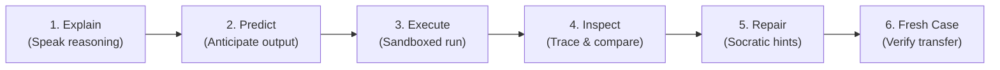
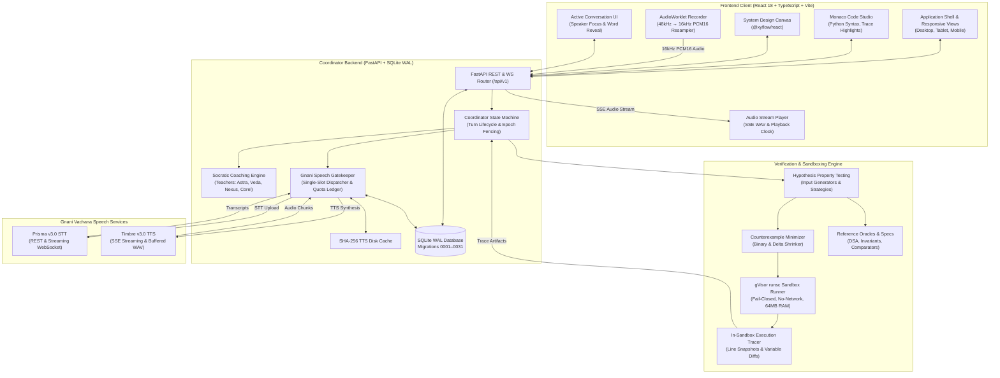
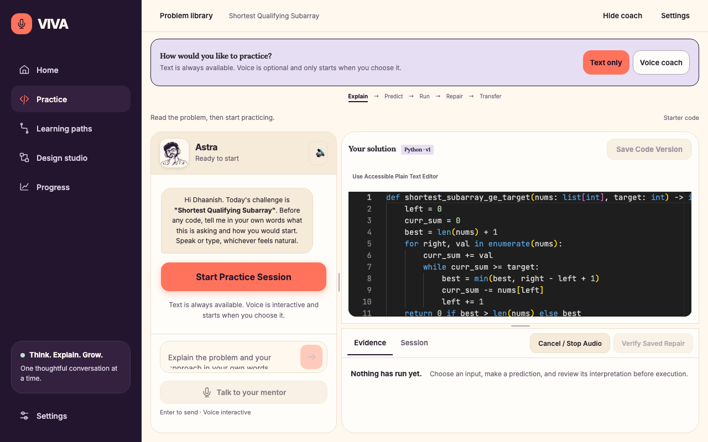
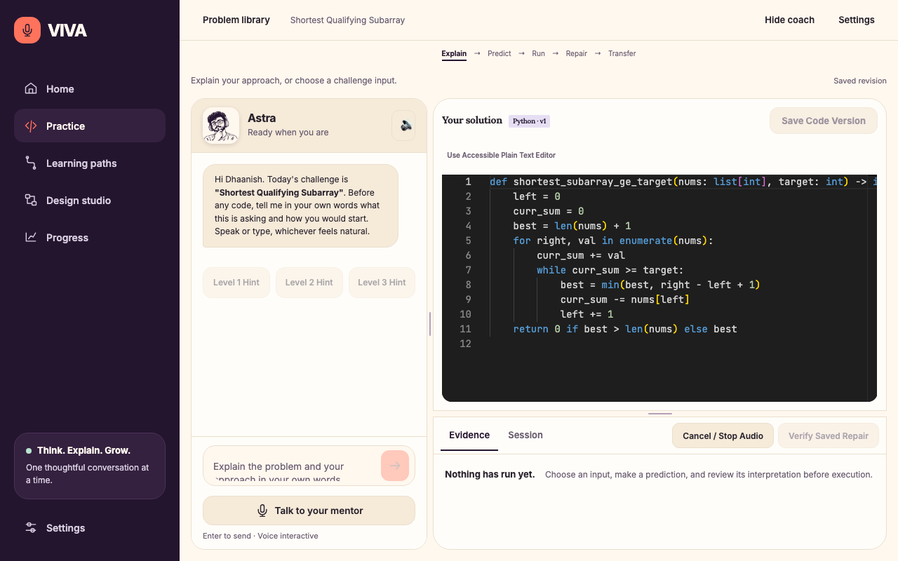
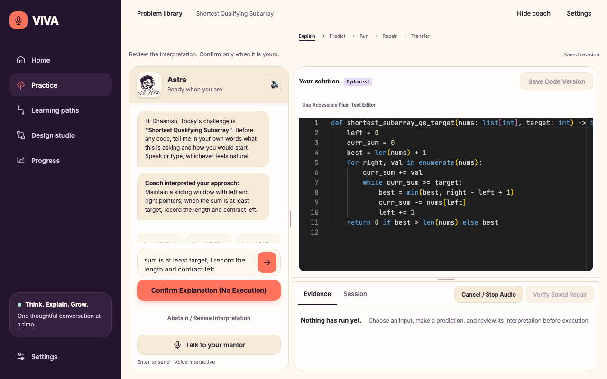
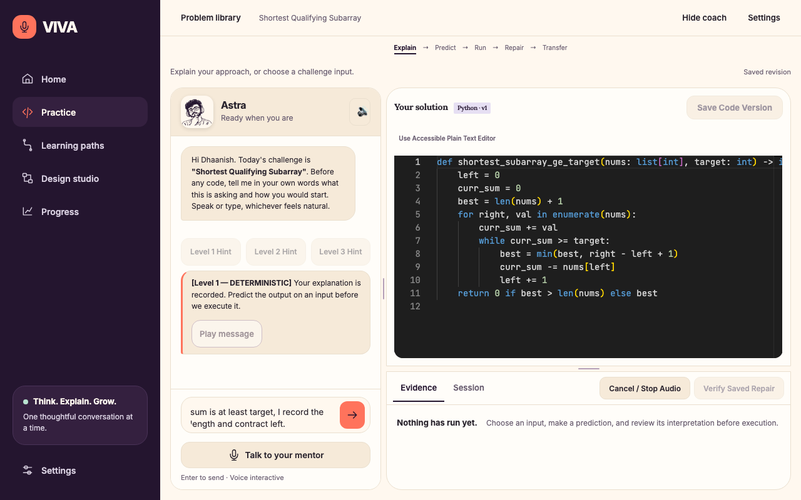
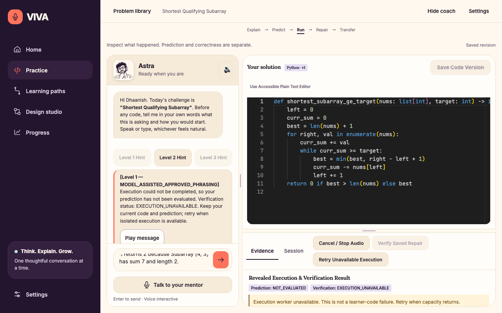
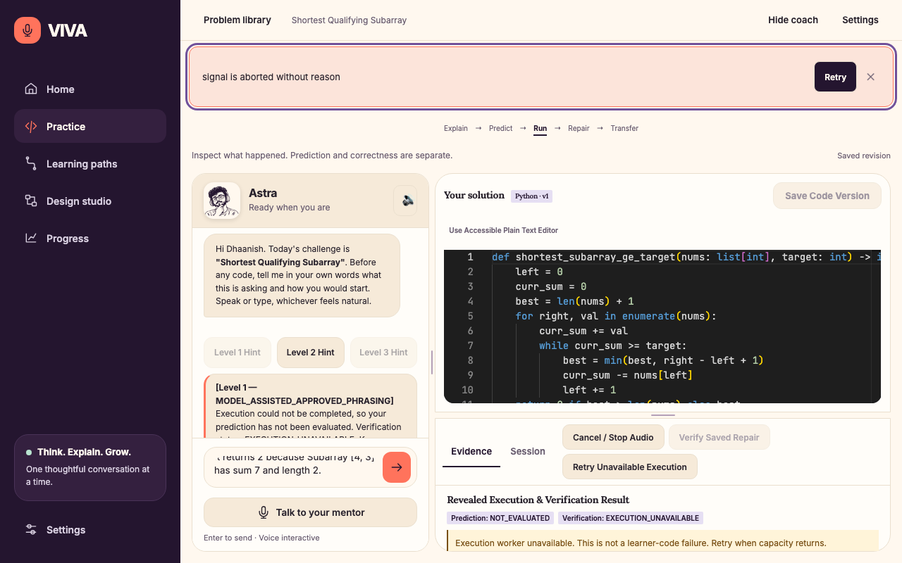
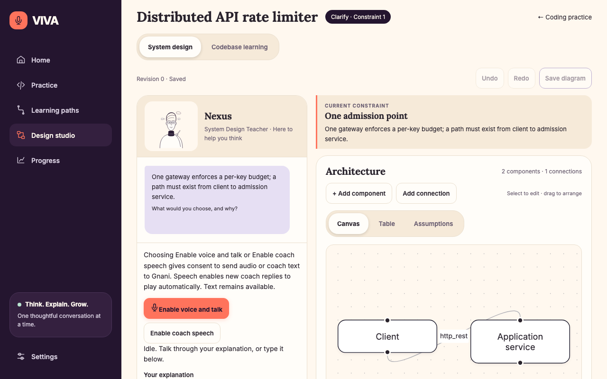

# Mentorly

> **Explain, predict, verify, and transfer.**  
> *A voice-first technical interview coaching and algorithmic learning platform powered by Gnani AI.*

[](https://gnani.ai/)
[](https://www.python.org/)
[](https://fastapi.tiangolo.com/)
[](https://react.dev/)
[](https://www.typescriptlang.org/)
[](https://vitejs.dev/)
[](#10-testing-and-verification)

*Formerly developed under the project working titles **Voice Coding Coach** and **Say Why**.*

---

## 📖 Table of Contents
1. [Overview](#1-overview)
2. [Key Features](#2-key-features)
3. [How It Works: The 6-Stage Socratic Loop](#3-how-it-works-the-6-stage-socratic-loop)
4. [Gnani AI Integration](#4-gnani-ai-integration)
5. [System Architecture](#5-system-architecture)
6. [Technology Stack](#6-technology-stack)
7. [Screenshots & Demo](#7-screenshots--demo)
8. [Getting Started](#8-getting-started)
9. [Testing and Verification](#9-testing-and-verification)
10. [Team & Contributions](#10-team--contributions)
11. [Challenges and Technical Decisions](#11-challenges-and-technical-decisions)
12. [Hackathon Context](#12-hackathon-context)
13. [Limitations and Future Roadmap](#13-limitations-and-future-roadmap)
14. [Acknowledgments and License](#14-acknowledgments-and-license)

---

## 1. Overview

### The Problem
Traditional coding platforms focus purely on binary outcomes: whether code passes a handful of predefined unit tests. This rewards "vibe coding" — guessing patches, copying patterns from memory, or memorizing solutions without genuine comprehension. 

In actual technical interviews at leading engineering companies, candidates fail not because they cannot type code, but because:
1. They cannot verbally explain their invariant assumptions or complexity trade-offs.
2. They cannot mentally trace execution flow through edge cases or negative values.
3. They fold when an interviewer presents a counterexample and asks: *"Why does your algorithm break here?"*

Meanwhile, commercial AI interview bots tend to hallucinate: they either falsely praise incorrect code or reject valid alternative algorithms because they lack deterministic execution verification.

### The Target Audience
- **Computer Science Students & Graduates** preparing for competitive technical interviews.
- **Software Engineers** seeking to sharpen their spoken technical reasoning and architectural defense skills.
- **Engineering Mentors** needing automated, evidence-backed diagnostic tools to assess candidate problem-solving depth.

### The Solution: Mentorly
**Mentorly** bridges the gap between spoken reasoning and program execution. Powered by **Gnani Vachana AI** speech services (**Prisma v3.0 STT** and **Timbre v3.0 TTS**), Mentorly listens to the learner's spoken explanation, captures their prediction on a challenging edge case, executes their code in an isolated sandbox, traces execution state line-by-line, and guides them Socraticly to diagnose, repair, and transfer their understanding.

---

## 2. Key Features

- **🎙️ Voice-First Socratic Coaching**: Natural spoken conversation supporting English (`en-IN`), Tanglish (`ta-IN,en-IN`), and regional speech modes with 13 distinct Gnani Timbre voices.
- **⚡ Deterministic Counterexample Search**: Uses Hypothesis property-based testing and automated shrinking to find minimal failing inputs that expose algorithmic boundary bugs.
- **🔍 Step-by-Step Execution Tracing**: Interactive variable snapshots and line execution timelines that expose exactly where state diverged from expectations.
- **💻 Integrated Monaco Code Studio & Plain-Text Fallback**: Full Python code editor with syntax highlighting, live trace line decorations, and an accessible plain-text toggle.
- **🧠 Comprehensive Multi-Track Curriculum**: 100 authored lessons across Data Structures & Algorithms, Computer Science Fundamentals, System Design, and Aptitude.
- **🏗️ Interactive System Design Studio**: Visual diagramming canvas using `@xyflow/react` where learners build microservice architectures and verbally defend trade-offs.
- **🛡️ Zero-Knowledge Repository Learning (Redrive)**: Ingests real code repositories, extracts dependency graphs via AST analysis, and auto-generates structured beginner learning plans and code defense questions.
- **📊 Evidence-Backed Evaluation Rubrics**: Mock technical interviews that generate immutable, citation-backed evaluation reports instead of subjective scores.
- **🔒 Fail-Closed Sandboxed Isolation**: Multi-tier execution architecture configured with gVisor (`runsc`) container isolation, zero network access, and strict CPU/memory limits.

---

## 3. How It Works: The 6-Stage Socratic Loop

Mentorly enforces an evidence-backed cognitive interaction cycle implemented in the coordinator state machine ([`state_machine.py`](file:///Users/dhaanish/Desktop/VIVA/implementation/backend/app/orchestration/state_machine.py)):



1. **Explain (`EXPLAINING`)**:  
   The candidate reads the problem specification and verbally explains their invariant approach, time complexity, and data structure choice into the microphone.
2. **Predict (`AWAITING_PREDICTION`)**:  
   Rather than immediately executing student code, the coach poses a targeted test case (often an edge case such as negative numbers, duplicates, or empty sets) and asks: *"What will your code return for this input, and why?"*
3. **Execute (`VERIFYING`)**:  
   The candidate's code is executed in an isolated sandbox against the target input alongside a trusted reference oracle.
4. **Inspect (`INSPECTING_RESULT`)**:  
   The workbench displays the student's output alongside the oracle result. If there is a mismatch or exception, line-by-line variable traces highlight the precise moment an assumption failed.
5. **Repair (`REPAIR_REQUIRED`)**:  
   Instead of revealing the solution, the Socratic mentor speaks graduated hints targeted to the observed bug category, prompting the learner to patch their code in Monaco.
6. **Try a Fresh Case (`FRESH_CASE_CHECK`)**:  
   Once the patch passes, the engine generates a novel, structurally distinct test case to ensure the learner has conceptually grasped the invariant rather than hardcoded a patch.

---

## 4. Gnani AI Integration

Mentorly utilizes **Gnani Vachana AI** speech infrastructure for speech recognition and voice synthesis:

| Gnani Technology | Component / Model | Endpoint / Wire Protocol | Application Role |
|---|---|---|---|
| **Gnani Prisma STT** | `prisma-v3.0` | `POST https://api.vachana.ai/stt/v3`<br>`wss://api.vachana.ai/stt/v3/stream` | Captures learner explanations and predictions via REST and streaming WebSockets with AST-derived keyterm hints. |
| **Gnani Timbre TTS** | `timbre-v3.0` | `POST https://api.vachana.ai/api/v1/tts/sse`<br>Buffered WAV REST | Streams mentor responses using SSE; supports 13 voices (default: *Avinash*) and 10 regional Indian locales. |
| **Speech Code-Mixing** | `en-IN`, `ta-IN,en-IN`, `hi-IN,en-IN` | Bilingual Language Models | Enables natural technical discussions in English, Tanglish, and Hinglish. |

### Audio Pipeline & Concurrency Engineering
- **AudioWorklet Resampling**: The frontend captures microphone audio using the Web Audio API and resamples arbitrary hardware rates (44.1 kHz / 48 kHz) to Gnani's required **16 kHz mono 16-bit linear PCM** via an off-thread `StatefulResampler`.
- **Framing & Chunking**: Audio uploads strictly adhere to a **960,000-byte (30-second)** buffer ceiling, with 1,024-byte streaming frames and terminal 512-byte boundaries.
- **Single-Slot Bounded Dispatcher**: A backend gatekeeper ([`gatekeeper.py`](file:///Users/dhaanish/Desktop/VIVA/implementation/backend/app/speech/gatekeeper.py)) wraps remote provider calls in an `asyncio.BoundedSemaphore(1)` to respect account concurrency limits without dropping learner turns.
- **Deterministic Disk Caching**: Frequent mentor prompts are cached on disk ([`tts_cache.py`](file:///Users/dhaanish/Desktop/VIVA/implementation/backend/app/speech/tts_cache.py)) using SHA-256 hashes of text, voice persona, and language mode, providing sub-millisecond audio replay with zero provider calls.
- **Transaction-Backed Ledger**: Speech reservations and physical provider calls are tracked inside SQLite WAL transactions (`usage_reservations`, `module_speech_usage`), ensuring accurate quota enforcement across reloads.

---

## 5. System Architecture

The following diagram illustrates Mentorly's production-candidate architecture:



---

## 6. Technology Stack

| Layer | Technology | Version | Purpose & Architectural Role |
|---|---|---|---|
| **Frontend Framework** | React | 18.3.1 | Core UI component hierarchy with concurrent rendering and error boundaries. |
| **Language (Client)** | TypeScript | 5.6.3 | Strict null-safe types synchronized with backend OpenAPI contracts. |
| **Build Tooling** | Vite | 6.4.6 | Fast HMR dev server and optimized production client bundling. |
| **Code Editor** | Monaco Editor | 0.57.0 | In-browser code editing with local web workers and custom execution trace line decorations. |
| **Visual Canvas** | `@xyflow/react` | 12.12.1 | Interactive node-based system design architecture canvas. |
| **Audio Processing** | Web Audio API | Standard | Native browser audio graph using `AudioWorkletNode` for zero-loss 16 kHz resampling. |
| **Backend Framework** | FastAPI | 0.115.6 | Async REST and WebSocket API coordinator with automated OpenAPI generation. |
| **Data Validation** | Pydantic | 2.10.3 | Strict schema validation, request filtering, and immutable domain models. |
| **Language (Server)** | Python | 3.11+ | Coordinator services, verification algorithms, and execution runners. |
| **Property Testing** | Hypothesis | 6.170.15 | Algorithmic test-case generation, invariant fuzzing, and shrinking. |
| **Code Parsing** | Tree-Sitter | 0.25.2 | Multi-language AST parsing for zero-knowledge repository learning (Redrive). |
| **Speech STT** | Gnani Prisma | v3.0 | Real-time speech-to-text recognition via REST and WebSockets. |
| **Speech TTS** | Gnani Timbre | v3.0 | Real-time voice synthesis streaming via SSE and buffered WAV. |
| **Database** | SQLite | 3.x (WAL) | Local transactional database with Write-Ahead Logging and 31+ migrations. |
| **Sandbox Isolation** | gVisor (`runsc`) | Docker OCI | Kernel-isolated container execution boundary for untrusted student code. |
| **Test Suites** | Pytest & Vitest | 8.3 / 4.1 | Automated verification: 1,276 backend tests and 734 frontend tests. |

---

## 7. Screenshots & Demo

### User Journey & Socratic Interaction

| 1. Landing & Session Setup | 2. Active Session & Code Studio |
|:---:|:---:|
|  |  |
| *Curriculum selection and microphone verification* | *Integrated Monaco editor and Socratic coach opening* |

| 3. Spoken Explanation Interpreted | 4. Prediction Confirmation |
|:---:|:---:|
|  |  |
| *Prisma STT captures spoken reasoning into an editable draft* | *Learner confirms their prediction on a targeted edge case* |

| 5. Sandbox Execution & Trace Inspector | 6. Spoken Hint & Socratic Debugging |
|:---:|:---:|
|  |  |
| *Fail-closed sandbox traces state and flags output divergence* | *Timbre TTS delivers graduated hints to guide code repair* |

### System Design Studio
  
*Interactive `@xyflow/react` architectural canvas with real-time spoken coaching from Nexus.*

### Video & Audio Verification Proofs
The [`recordings/`](file:///Users/dhaanish/Desktop/VIVA/recordings/) directory contains genuine captured video and audio demonstrations:
- **Full Voice-First Demo Video**: [`viva_voice_first_demo.mp4`](file:///Users/dhaanish/Desktop/VIVA/recordings/viva_voice_first_demo.mp4) (2.2 MB full interaction walkthrough)
- **Mentor Voice Proof**: [`mentor_voice_proof.mp4`](file:///Users/dhaanish/Desktop/VIVA/recordings/mentor_voice_proof.mp4) (Gnani Timbre voice synthesis proof)
- **System Design Voice Proof**: [`system_design_mentor_voice_proof.mp4`](file:///Users/dhaanish/Desktop/VIVA/recordings/system_design_mentor_voice_proof.mp4) (Spoken architectural review)
- **Raw Audio Samples**: [`mentor_voice.wav`](file:///Users/dhaanish/Desktop/VIVA/recordings/mentor_voice.wav) and [`user_voice.wav`](file:///Users/dhaanish/Desktop/VIVA/recordings/user_voice.wav)

---

## 8. Getting Started

### 1. Prerequisites
- **Python**: 3.11+
- **Node.js**: 20+ (with `npm`)

### 2. Environment Configuration
Copy the secret-free environment template to `.env`:
```bash
cp implementation/.env.example .env
```

Key environment variables in `.env`:
```ini
# Environment & Database
VCC_ENV=development
VCC_BRANDING_CONFIG_PATH=./config/branding.json
VCC_DATABASE_PATH=./data/vcc.db
VCC_CORS_ORIGINS=http://localhost:5173

# Gnani Vachana Speech Services (Configure your credentials)
VCC_GNANI_API_KEY=your_gnani_api_key_here
VCC_GNANI_BASE_URL=https://api.vachana.ai
VCC_GNANI_STT_MODEL=prisma-v3.0
VCC_GNANI_TTS_MODEL=timbre-v3.0
VCC_GNANI_TTS_VOICE=Avinash
VCC_GNANI_STT_TRANSPORT=rest
VCC_GNANI_MAX_CONCURRENCY=1

# Sandbox & Safety Flags
VCC_ALLOW_PUBLIC_CUSTOM_CODE=false
```

### 3. Backend Setup
From the repository root:
```bash
# Create and activate virtual environment
python3 -m venv .venv
source .venv/bin/activate

# Install backend dependencies
pip install -r implementation/backend/requirements.txt

# Start backend with live source reloading on port 8000
python implementation/scripts/start_local.py --env-file .env --port 8000
```
> [!TIP]
> **Credential-Free Preview Mode:** To run the backend without live Gnani credentials (using local mock speech adapters):
> ```bash
> python implementation/scripts/start_local.py --preview --port 8000
> ```
> Interactive Swagger API documentation will be available at `http://127.0.0.1:8000/docs`.

### 4. Frontend Setup
In a separate terminal, from the repository root:
```bash
# Install frontend dependencies
npm --prefix implementation/frontend ci

# Launch Vite development server on port 5173
npm --prefix implementation/frontend run dev
```
Open `http://localhost:5173` in your browser. The Vite development server automatically proxies `/api` requests to `http://127.0.0.1:8000`.

---

## 9. Testing and Verification

Mentorly enforces strict test-driven verification across both frontend and backend codebases.

### Automated Test Results
- **Backend & Worker Suites**: **1,276 passed**, 14 skipped, 5 warnings; **88% statement coverage** in 67.59s.  
  *(Skips reflect optional PostgreSQL testbeds and live gVisor daemon acceptance requiring dedicated Linux hosts).*
- **Frontend Vitest Suites**: **734 passed** across 47 suites; **88.80% statements**, 83.47% branches, 87.68% functions, 95.24% lines.
- **Contract Drift & Secret Audits**: Zero schema drift across 27 enums and 61 interfaces; zero secret violations.

### Verification Commands
Run the complete verification suite from the repository root:

```bash
# 1. Run backend unit and integration test suite with coverage
PYTHONPATH=implementation/backend:implementation python3 -m pytest \
  implementation/backend/tests implementation/exec_worker/tests -q -rs --cov=implementation/backend/app --cov-report=term

# 2. Run frontend Vitest test suite with coverage
npm --prefix implementation/frontend test -- --coverage

# 3. Frontend TypeScript typechecking
npm --prefix implementation/frontend run typecheck

# 4. Frontend linting
npm --prefix implementation/frontend run lint

# 5. Production frontend bundle build
npm --prefix implementation/frontend run build

# 6. Contract synchronization check (OpenAPI vs. TypeScript)
PYTHONPATH=implementation/backend:implementation python3 implementation/backend/scripts/export_openapi.py --check
npm --prefix implementation/frontend run contracts:check

# 7. Schema drift and mutation self-test
PYTHONPATH=implementation/backend:implementation python3 implementation/scripts/check_schema_drift.py --check --self-test

# 8. Secret hygiene audit
python3 implementation/scripts/check_secrets.py
```

---

## 10. Team & Contributions

Mentorly was conceptualized, architected, and built by a two-member engineering team for the Gnani AI Challenge:

### Dhaanish Ahamed B — Architecture, Backend and Verification
- **GitHub:** [@dhaanish597](https://github.com/dhaanish597)
- **Primary Technical Focus:** System architecture, FastAPI REST/WebSocket endpoints, coordinator state machine, Hypothesis property-based testing and counterexample minimization, gVisor execution sandbox runner, Gnani API backend adapter and quota gatekeeper, SQLite WAL database with 31+ migrations, and backend verification.

### Aishwarya K — Frontend, Voice Experience and UX
- **Primary Technical Focus:** React 18 and TypeScript client architecture, Monaco code editor integration with trace line highlights, Web Audio API AudioWorklet capture with zero-loss 16 kHz resampler, Gnani SSE/WAV playback handling, Socratic active conversation panel with progressive word reveals, `@xyflow/react` system design studio, evidence visualization, and frontend test suites.

> [!NOTE]
> In the Git repository history, commits were committed and pushed primarily via Dhaanish's account (`dhaanish597`) due to co-located pairing and consolidated integration pipelines. A detailed breakdown of individual contributions, collaborative workflows, and module ownership is documented in:
> 
> 👉 **[View Detailed Team Contributions (CONTRIBUTIONS.md)](CONTRIBUTIONS.md)**

---

## 11. Challenges and Technical Decisions

1. **Epoch & Revision Fencing**:  
   *Decision:* When learners edit code while speech recognition or test execution is pending, naive architectures apply stale feedback to new code. We implemented strict epoch and revision fencing: every operation is tagged with `(revision, turn_id)`. Modifying code immediately triggers an `AbortController` cancel signal, invalidating in-flight remote requests.
2. **Zero-Loss AudioWorklet Resampling**:  
   *Decision:* Rather than using deprecated, main-thread `ScriptProcessorNode` interfaces that drop audio buffers under UI load, we built an off-thread `AudioWorkletNode` resampler. It converts 48 kHz browser audio to 16 kHz PCM16 in 128-sample quanta with zero lost samples.
3. **Fail-Closed Execution Isolation**:  
   *Decision:* Untrusted learner code is never executed via raw host subprocesses or insecure AST filters. We engineered a gVisor (`runsc`) container specification with network denial and strict CPU/RAM quotas. In environments where gVisor is not verified, arbitrary execution fails closed.
4. **Single-Slot Bounded Quota Dispatcher**:  
   *Decision:* To prevent `429 Too Many Requests` errors on speech APIs with strict single-request concurrency limits, we built a centralized gatekeeper with `asyncio.BoundedSemaphore(1)` and SQLite WAL transaction-backed reservation counters.
5. **Deterministic Grounding vs. LLM Hallucination**:  
   *Decision:* LLMs are strictly prohibited from evaluating code correctness. All outputs, traces, and counterexamples are generated deterministically by Python reference oracles and Hypothesis test suites. The Socratic coach only interprets verified execution artifacts.

---

## 12. Hackathon Context

This project was developed for the **Gnani AI Great Indian AI Internship Challenge**.

Mentorly demonstrates the transformative potential of **Gnani Vachana Speech AI** in technical education and developer assessment. By combining high-accuracy Indian-English and Tanglish speech recognition (**Prisma v3.0**) with natural regional voice synthesis (**Timbre v3.0**), Mentorly makes technical interview coaching accessible, conversational, and grounded in engineering reality.

---

## 13. Limitations and Future Roadmap

We believe in complete technical honesty regarding our current implementation status:

### Implemented & Verified in Candidate Release
- ✅ Complete six-stage Socratic coaching loop (Explain → Predict → Execute → Inspect → Repair → Fresh Case).
- ✅ Real Gnani Prisma STT (REST & WS) and Timbre TTS (SSE & WAV) integration.
- ✅ Offline and local property-based counterexample generation and minimization via Hypothesis.
- ✅ Local Monaco code editor with execution trace stepping and plain-text fallback.
- ✅ System Design canvas studio with spoken architectural review.
- ✅ 100 authored curriculum lessons across DSA, CS, Design, and Aptitude.
- ✅ 1,276 backend tests and 734 frontend tests passing.

### Current Limitations & Future Roadmap
- ⏳ **Public Arbitrary Code Sandbox:** While the gVisor runner is fully specified and tested locally on Linux, public arbitrary code execution remains disabled (`VCC_ALLOW_PUBLIC_CUSTOM_CODE=false`) until production cluster acceptance is completed.
- ⏳ **PostgreSQL Multi-Tenant Cluster:** The current production candidate uses SQLite with WAL mode. Experimental PostgreSQL repositories exist but require distributed lock migration before cloud multi-region deployment.
- ⏳ **Full Multilingual Localization:** While Gnani supports 10 locales and Tanglish code-mixing, complete interface localization and translated lesson content are planned for future releases.

---

## 14. Acknowledgments and License

- **Gnani AI**: For providing the Vachana speech infrastructure (Prisma STT and Timbre TTS) that powers Mentorly's voice engine.
- **Open Source Community**: Built using FastAPI, React, Monaco Editor, `@xyflow/react`, Hypothesis, and Vite.
- **License**: Built for the Gnani AI Great Indian AI Internship Challenge. All rights reserved by the project authors (Dhaanish Ahamed B & Aishwarya K).
